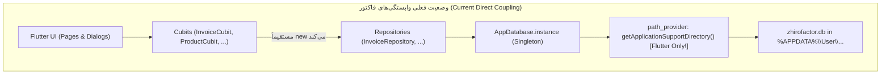
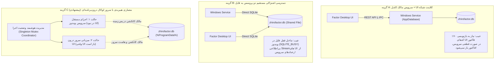
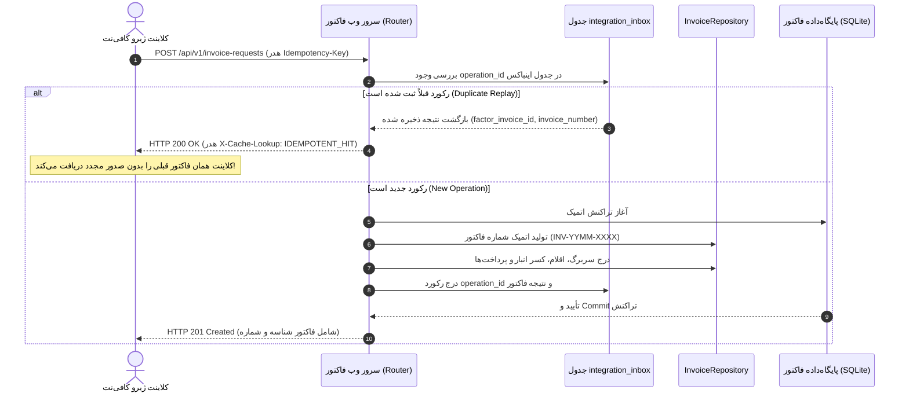
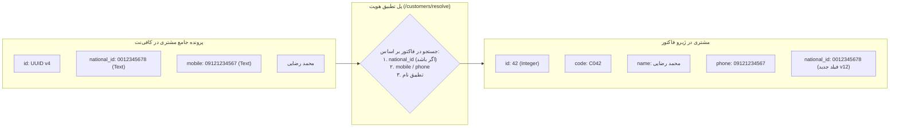
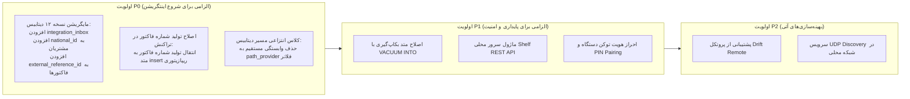
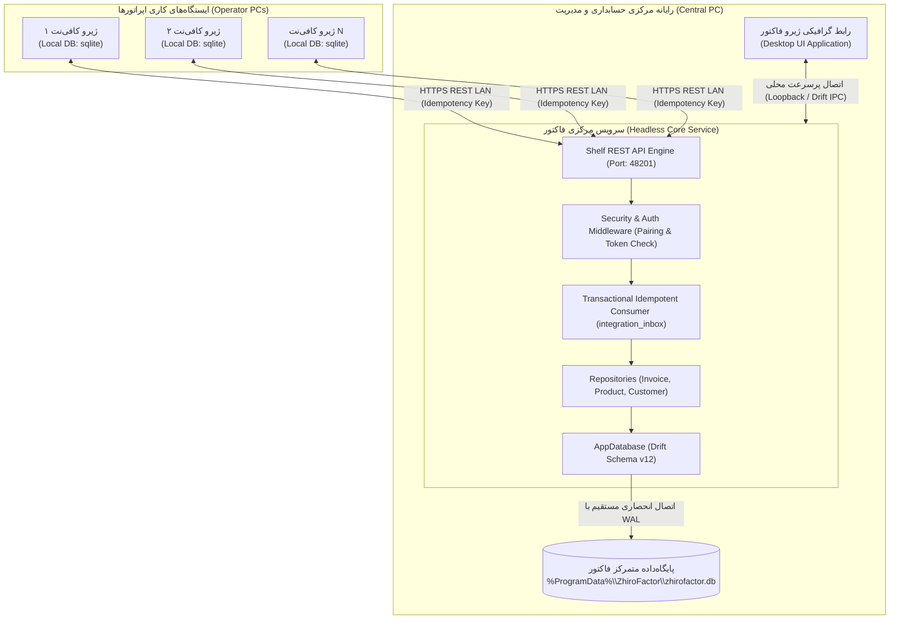

# بازبینی انتقادی سازگاری معماری ژیرو کافی‌نت با ژیرو فاکتور
## ارزیابی جامع معماری، پایگاه‌داده، سرویس ویندوز، امنیت شبکه و ارتباط آفلاین

> **سند فنی:** Zhiro Cafinet — Independent Architecture Compatibility Review  
> **مسیر سند:** `docs/architecture/ZHIRO_CAFINET_COMPATIBILITY_REVIEW.md`  
> **نقش بررسی‌کننده:** Senior Software Architect، Flutter/Dart Architect و متخصص SQLite/Drift، Windows Services و Distributed Systems  
> **مبنای ممیزی:** کدهای واقعی مخزن ژیرو فاکتور (`sales_box` نسخه ۱.۰.۱۰)، اسناد معماری مصوب ژیرو کافی‌نت، قوانین و اسکیلهای فنی توسعه‌دهنده  
> **تاریخ بازبینی:** نوامبر ۲۰۲۶ (آبان ۱۴۰۵)  
> **وضعیت ارزیابی نهایی:** **`READY AFTER REQUIRED CHANGES` (آماده برای اجرا پس از اعمال اصلاحات ساختاری در فاکتور)**

---

## ۱. چکیده اجرایی (Executive Summary)

این گزارش یک ممیزی معماری عمیق، مستقل و بدون تعارف مهندسی از طرح پیشنهادی نرم‌افزار **ژیرو کافی‌نت (Zhiro Cafinet)** در انطباق با کدهای واقعی و وضعیت کنونی نرم‌افزار **ژیرو فاکتور (Zhiro Factor / مخزن `sales_box`)** است.

### ارزیابی کلان معماری پیشنهادی:
1. **طراحی مفهومی ژیرو کافی‌نت (Zhiro Cafinet) بسیار قدرتمند و استاندارد است:** تصمیم به استقلال ۱۰۰ درصدی محصول (Zero Mandatory Dependency)، استفاده از پایگاه‌داده محلی SQLite/Drift برای هر اپراتور، بهره‌گیری از شناسه‌های پایدار UUID v4، استفاده از الگوی **Transactional Outbox** و تضمین تحویل رویدادها با الگوی At-Least-Once به همراه Idempotent Consumer، بهترین و پخته‌ترین تصمیم معماری برای یک سیستم Offline-First است.
2. **اما تعامل با ژیرو فاکتور دارای تعارضات و چالش‌های فنی پنهان است:** فرضیاتی که در اسناد معماری کافی‌نت (به‌ویژه در ADR-004، ADR-005 و قراردادهای اینتگریشن) در مورد «سادگی اجرای ویندوز سرویس فاکتور» و «مالکیت انحصاری دیتابیس توسط سرویس» در نظر گرفته شده است، با **کد واقعی موجود در `sales_box`** ناسازگاری‌های جدی دارد.
3. **بزرگ‌ترین موانع فنی کشف‌شده در کد واقعی فاکتور:**
   - **وابستگی به Flutter Engine در مسیر دیتابیس:** کلاس [lib/core/database/app_database.dart](file:///d:/Workspace/Flutter/sales_box/lib/core/database/app_database.dart#L46-L49) برای تعیین مسیر دیتابیس از `getApplicationSupportDirectory()` پکیج `path_provider` استفاده می‌کند. اجرای یک ویندوز سرویس مستقل به صورت Dart CLI Standalone بدون حضور فریم‌ورک Flutter، به دلیل عدم وجود Platform Channels، بلافاصله با `MissingPluginException` کرش خواهد کرد.
   - **وابستگی مسیر دیتابیس به پروفایل کاربر جاری:** مسیر فعلی `getApplicationSupportDirectory()` در ویندوز زیرشاخه `%APPDATA%` کاربر لاگین‌شده است. ویندوز سرویسی که با حساب `LocalSystem` یا `NT SERVICE` اجرا شود، به پوشه سیستم‌پروفایل اشاره خواهد کرد و در عمل **دو پایگاه‌داده کاملاً مجزا و موازی** تشکیل خواهد شد.
   - **شکنندگی فرضیه تک‌مالکیتی (Single Owner) در UI موجود فاکتور:** رابط کاربری فعلی فاکتور یک کلاینت تحت وب یا API-based نیست؛ بلکه بیش از ۲۵ کنترلر Cubit و صدها ویجت مستقیماً از طریق ریپازیتوری‌های محلی (`InvoiceRepository`, `ProductRepository`, `ReportRepository`) به نمونه سراسری `AppDatabase.instance` متصل هستند. تبدیل UI فاکتور به یک کلاینت تحت REST API مستلزم بازنویسی بیش از ۷۰٪ کدهای UI و حذف مستقیم ریپازیتوری‌هاست که ریسک و هزینه نامعقولی دارد.
   - **Race Condition در تولید شماره فاکتور:** متد `nextCounter()` در [lib/data/repositories/invoice_repository.dart](file:///d:/Workspace/Flutter/sales_box/lib/data/repositories/invoice_repository.dart#L524-L530) به صورت غیراَتمیک خارج از تراکنش فراخوانی می‌شود. در یک محیط چنداپراتوره LAN، ارسال همزمان دو درخواست منجر به تولید شماره فاکتور یکسان و خطای نقض کلید یکتا (`UNIQUE constraint failed: invoices.invoice_number`) خواهد شد.
   - **عدم وجود جداول و فیلدهای شناسه بیرونی در فاکتور:** فاکتور در نگارش فعلی دیتابیس (نسخه ۱۱) فاقد فیلد `national_id` در جدول مشتریان، فاقد `external_reference_id` در فاکتورها و فاقد جدول `integration_inbox` است.
   - **ریسک فساد یا از دست رفتن داده در بکاپ‌گیری با WAL:** متد `_autoBackup()` در فاکتور از `File.copy()` خام استفاده می‌کند. در صورت فعال بودن WAL، کپی خام فایل `.db` بدون فایل‌های `-wal` و `-shm` یا بدون اجرای چِک‌پوینت، منجر به بکاپ‌های ناقص و فاقد تراکنش‌های اخیر خواهد شد.

### راهکار محوری ارائه‌شده در این گزارش:
معرفی **معماری هیبریدی هسته فاکتور (Headless Core Service) با استفاده از قابلیت Drift Remote Protocol یا Embedded Host**: تفکیک اتصال دیتابیس به مسیر مشترک سیستمی `%ProgramData%\ZhiroFactor\zhirofactor.db`، ارتقای دیتابیس فاکتور به نگارش ۱۲، انتقال شماره‌گذاری فاکتور به داخل تراکنش اتمیک، و پیاده‌سازی سرویس مرکزی با کمترین تخریب در کدهای موجود دسکتاپ فاکتور.

---

## ۲. محدوده بازبینی و ممیزی (Review Scope)

این بازبینی تمام بخش‌های زیر را در بر می‌گیرد:
- **تحلیل کد واقعی مخزن Zhiro Factor (`sales_box`):** فایل‌های ورودی، لایه‌های Presentation، لایه دیتابیس Drift، ریپازیتوری‌ها، مدل‌ها، سرویس‌های زیرساختی و آزمون‌های واحد موجود.
- **انطباق با اسناد معماری Zhiro Cafinet:** بررسی اسناد معماری، مدل داده، قراردادهای تبادل داده (API Contracts)، استراتژی همگام‌سازی آفلاین، تصمیمات ADR و نقشه راه پیاده‌سازی.
- **انطباق با قوانین و اسکیلهای فنی توسعه‌دهنده:** بررسی انطباق با استانداردهای `flutter-preferred-stack.md`، دستورالعمل‌های `flutter-global-core.md` و پکیج ابزارهای اختصاصی `prokit`.
- **ارزیابی عملیاتی سیستم‌های توزیع‌شده محلی (LAN Distributed Systems):** تحلیل ترافیک شبکه، امنیت انتقال، تهدیدات مبتنی بر مرورگر (DNS Rebinding/CORS)، بازیابی از کرش، همزمانی SQLite و تاب‌آوری آفلاین.

---

## ۳. اسناد و مراجع بررسی‌شده (Reviewed Documents)

| عنوان سند مرجع | مسیر / منبع بررسی | وضعیت بررسی | تطبیق با کد واقعی |
|---|---|:---:|---|
| **ZHIRO_FACTOR_ARCHITECTURE_AUDIT.md** | `docs/architecture/ZHIRO_FACTOR_ARCHITECTURE_AUDIT.md` | بررسی کامل شد | گزارش پایه با جزئیات کد مطابقت دارد؛ برخی تفاوت‌ها (مانند نوع ستون `date` که متنی است نه DateTime) شفاف شد. |
| **ZHIRO_CAFINET_ARCHITECTURE.md** | محتوای سند جامع معماری کافی‌نت (دریافتی از کاربر) | بررسی کامل شد | اصول آفلاین‌محور و Outbox بسیار عالی است؛ فرضیه ویندوز سرویس فاکتور نیازمند بازنگری اجرایی است. |
| **ZHIRO_CAFINET_DATA_MODEL.md** | محتوای سند جامع مدل داده کافی‌نت (دریافتی از کاربر) | بررسی کامل شد | مدل داده بر پایه UUID v4 و متن برای کدهای ملی کاملاً تایید می‌شود؛ نگاشت شناسه‌ها نیازمند فیلد جدید در فاکتور است. |
| **ZHIRO_INTEGRATION_CONTRACTS.md**| محتوای سند مشخصات قراردادهای یکپارچه‌سازی (دریافتی از کاربر) | بررسی کامل شد | ساختار پاکت و فیلدهای DTO عالی است؛ نیازمند اصلاحاتی در بخش تولید شماره فاکتور و وضعیت محصولات غیرفعال است. |
| **ZHIRO_SYNC_ARCHITECTURE.md** | محتوای سند معماری همگام‌سازی و تاب‌آوری (دریافتی از کاربر) | بررسی کامل شد | الگوی Transactional Outbox + Exponential Backoff کاملاً تایید می‌شود و با منطق مالی همخوانی دارد. |
| **ZHIRO_TECHNICAL_DECISIONS.md** | محتوای ADRهای ۱۴‌گانه (دریافتی از کاربر) | بررسی کامل شد | ADR-004 و ADR-005 در خصوص مالکیت یگانه دیتابیس نیازمند اصلاح فنی هستند. سایر ADRها تایید شدند. |
| **ZHIRO_CAFINET_ROADMAP.md** | محتوای نقشه راه ۶ فازی (دریافتی از کاربر) | بررسی کامل شد | فازبندی منطقی است؛ فاز ۵ (سرویس فاکتور) باید دارای پیش‌نیاز مهاجرت فاکتور باشد. |
| **ZHIRO_ECOSYSTEM_ARCHITECTURE.md**| جستجو در کل ساختار دایرکتوری مخزن | **یافت نشد** | این فایل به صورت مستقل در مخزن وجود نداشت؛ مفاهیم اکوسیستم از طریق تلفیق سایر اسناد و مستندات قبلی استخراج گردید. |

---

## ۴. اسکیلهای اختصاصی توسعه‌دهنده (Reviewed Personal Skills)

در جریان این ممیزی معماری، اسکیلها و قوانین زیر به عنوان مراجع بالادستی مورد بازرسی و اعمال قرار گرفتند:

1. **قانون هسته توسعه فلاتر (`flutter-global-core.md`):**
   - *مسیر:* [C:\Users\mohse\.gemini\config\rules\flutter-global-core.md](file:///C:/Users/mohse/.gemini/config/rules/flutter-global-core.md)
   - *کاربرد در بازبینی:* پایبندی به اصل «کشف پیش از ویرایش»، حفظ معماری موجود فاکتور بدون تحمیل بازنویسی‌های غیرمجاز، و راستی‌آزمایی دقیق با شواهد عینی کد مخزن.
2. **پشته فنی ترجیحی توسعه‌دهنده (`flutter-preferred-stack.md`):**
   - *مسیر:* [C:\Users\mohse\.gemini\config\rules\flutter-preferred-stack.md](file:///C:/Users/mohse/.gemini/config/rules/flutter-preferred-stack.md)
   - *کاربرد در بازبینی:* ارزیابی استفاده از BLoC/Cubit، الگوی تمیز Clean Architecture، کتابخانه Drift برای پایگاه‌داده، GoRouter برای مسیریابی و GetIt برای تزریق وابستگی. تطبیق تصمیمات معماری کافی‌نت با این استانداردها.
3. **پکیج ابزارهای شخصی `prokit` (`prokit/SKILL.md`):**
   - *مسیر:* [C:\Users\mohse\.gemini\config\skills\prokit\SKILL.md](file:///C:/Users/mohse/.gemini/config/skills/prokit/SKILL.md)
   - *کاربرد در بازبینی:* بررسی خطوط قرمز امنیتی و فنی ابزارها:
     - ممنوعیت اکید استفاده از `kDebugToken` و ماژول `ENC` (به دلیل کلیدهای ثابت).
     - ممنوعیت ویجت‌های ناپایدار انتخاب (`CustomCheckBox` و `MultiSelectableList`).
     - اجتناب از تداخل `TimeExtension` بین `date_helper.dart` و `time.dart`.
     - رعایت ترتیب زنجیره اعتبارسنجی `Validate(value)`.
     - تایید استفاده از افزونه‌های عددی `number_extensions.dart` و تقویم جلالی `calendar.dart`.

---

## ۵. تحلیل معماری واقعی ژیرو فاکتور (Actual Factor Architecture)

بر اساس بازرسی مستقیم کدهای منبع در شاخه `lib/` مخزن `sales_box`:

### ۵.۱ ساختار لایه‌ها و میزان استقلال از UI
- **Presentation Layer:** صفحات و دیالوگ‌ها در `lib/features/*/view/` مستقیماً به Cubitها متصل هستند. هیچ لایه واسط شبکه‌ای در UI وجود ندارد.
- **Business Logic Layer:** منطق سیستم در Cubitهای تک‌راستایی سازمان‌یافته است. برای مثال، [lib/features/invoice/cubit/invoice_cubit.dart](file:///d:/Workspace/Flutter/sales_box/lib/features/invoice/cubit/invoice_cubit.dart) مستقیماً نمونه‌ای از `InvoiceRepository` را به صورت فیلد خصوصی می‌سازد (`final InvoiceRepository _repository = InvoiceRepository();`). این یعنی BLoC/Cubitها از تزریق وابستگی (DI) با GetIt استفاده نمی‌کنند، بلکه وابستگی مستقیم دارند.
- **Repository Layer:** کلاس‌های ریپازیتوری در `lib/data/repositories/` (نظیر `InvoiceRepository`, `ProductRepository`, `CustomerRepository`) از نظر منطق کوئری‌ها کاملاً مستقل از Flutter UI هستند و با متدهای بازگشتی آینده (`Future`) و مدل‌های داده مستقل کار می‌کنند.
- **Database & Core Layer:** دیتابیس در فایل [lib/core/database/app_database.dart](file:///d:/Workspace/Flutter/sales_box/lib/core/database/app_database.dart) به عنوان یک سینگلتون سراسری (`AppDatabase.instance`) تعریف شده است.



### ۵.۲ تحلیل دقیق چرخه ثبت فاکتور (`InvoiceRepository.insert`)
بررسی خطوط ۲۹۱ الی ۳۴۷ فایل [lib/data/repositories/invoice_repository.dart](file:///d:/Workspace/Flutter/sales_box/lib/data/repositories/invoice_repository.dart):
1. **تراکنش اتمیک:** عملیات ثبت سربرگ فاکتور، درج اقلام (`invoiceItems`)، کسر انبار و درج پرداخت‌ها در قالب یک تراکنش واحد اتمیک دیتابیس اجرا می‌شود (`await _db.transaction(() async { ... });`).
2. **کسر هوشمند انبار خدمات:** دستور `UPDATE products SET stock = stock - ? WHERE id = ? AND stock IS NOT NULL` تضمین می‌کند که اقلام خدماتی که در دیتابیس فاکتور دارای `stock = null` هستند، کسر موجودی نخورده و عملیات بدون خطا انجام می‌شود.
3. **اسنپ‌شات بهای تمام‌شده:** فیلد `purchasePrice` در زمان فروش به عنوان اسنپ‌شات در جدول `invoice_items` ذخیره می‌شود (خط ۳۱۶) تا سود فروش گذشته با تغییر بعدی قیمت کالا مخدوش نگردد.
4. **نقص بحرانی همزمانی در تولید شماره فاکتور:**
   - متد `insert` شماره فاکتور را خودش تولید نمی‌کند! بلکه مقدار `invoice.invoiceNumber` ارسالی از مدل ورودی را درج می‌کند.
   - تولید شماره فاکتور توسط `InvoiceCubit.initNew()` در زمان باز شدن فرم انجام می‌شود:
     ```dart
     final counter = await _repository.nextCounter();
     final invoiceNumber = InvoiceNumberGenerator.generate(counter);
     ```
   - متد `nextCounter()` کوئری `max(id) + 1` را اجرا می‌کند.
   - **آسیب‌پذیری:** اگر دو درخواست صدور فاکتور از دو ایستگاه کافی‌نت همزمان به سرویس فاکتور برسد، هر دو مقدار یکسانی برای `nextCounter()` دریافت کرده و با خطای `UNIQUE constraint failed: invoices.invoice_number` رد می‌شوند!

---

## ۶. ماتریس سازگاری جامع (Comprehensive Compatibility Matrix)

| بخش / مؤلفه | تصمیم یا قابلیت پیشنهادی Cafinet | وضعیت سازگاری | سطح اهمیت | شواهد فنی در کد فاکتور و تحلیل اثرات |
|---|---|:---:|:---:|---|
| **مدل استقلال محصول** | کارکرد ۱۰۰٪ مستقل و آفلاین کافی‌نت با دیتابیس اختصاصی | **Compatible** | - | دیتابیس محلی کافی‌نت هیچ وابستگی به فاکتور ندارد و ۱۰۰٪ مستقل است. |
| **الگوی Transactional Outbox** | ثبت سفارش محلی و درج همزمان در `outbox_messages` | **Compatible** | - | الگوی استاندارد در SQLite بدون نیاز به دستکاری فاکتور. |
| **فناوری ویندوز سرویس فاکتور** | اجرای سرویس مستقل با `dart compile exe` | **Compatible With Changes** | **Critical** | در [app_database.dart](file:///d:/Workspace/Flutter/sales_box/lib/core/database/app_database.dart#L47)، استفاده از `path_provider` مانع اجرای دسکتاپ بدون Flutter می‌شود. نیازمند بازآرایی مسیر. |
| **مالکیت یگانه دیتابیس فاکتور** | تبدیل UI فاکتور به کلاینت تحت وب یا API | **Not Compatible** | **Critical** | نیازمند بازنویسی بیش از ۷۰٪ فاکتور و حذف تمام ریپازیتوری‌های مستقیم UI. راهکار جایگزین (Drift Remote / Embedded Server) پیشنهاد شد. |
| **مسیر ذخیره دیتابیس فاکتور** | انتقال دیتابیس به `%ProgramData%\ZhiroFactor` | **Compatible With Changes** | **High** | در حال حاضر دیتابیس در مسیر کاربری `%APPDATA%` است. نیازمند اسکریپت جابجایی امن فایل در اینستالر. |
| **تولید شماره فاکتور در همزمانی** | فاکتور توسط کلاینت‌ها بدون شماره ارسال و سرور تولید کند | **Compatible With Changes** | **Critical** | متد `InvoiceRepository.insert` باید تولید شماره فاکتور را داخل تراکنش اتمیک انجام دهد نه در UI. |
| **تکرارناپذیری صدور فاکتور (Idempotency)** | ارسال هدر `Idempotency-Key` و `operationId` | **Compatible With Changes** | **Critical** | فاکتور فعلی فاقد جدول `integration_inbox` یا فیلد `external_reference_id` در جدول `invoices` است. |
| **شناسایی و تطبیق مشتریان** | تطبیق مشتری با `national_id` در اندپوینت `/customers/resolve` | **Compatible With Changes** | **High** | جدول `customers` در فاکتور [tables.dart:27](file:///d:/Workspace/Flutter/sales_box/lib/core/database/tables.dart#L27) فاقد فیلد `national_id` است. باید در نسخه ۱۲ اضافه شود. |
| **تفکیک کالا از خدمات در صدور فاکتور** | عدم کسر موجودی برای خدمات کافی‌نت | **Compatible** | - | در [invoice_repository.dart:327](file:///d:/Workspace/Flutter/sales_box/lib/data/repositories/invoice_repository.dart#L327) با شرط `stock IS NOT NULL` کاملاً اثبات و تایید شد. |
| **تثبیت قیمت آفلاین (Historical Price)** | پذیرش نرخ ثبت‌شده در آفلاین در زمان تغییر قیمت فاکتور | **Compatible** | - | متد `insert` فاکتور نرخ ارسالی در اقلام را بدون رونویسی با قیمت روز محصول می‌پذیرد. |
| **پشتیبان‌گیری خودکار در زمان اجرا** | کپی فایل دیتابیس با متد `_autoBackup()` | **Compatible With Changes** | **High** | با فعال بودن حالت WAL، کپی خام `File.copy` فاقد داده‌های WAL است. باید از `VACUUM INTO` استفاده شود. |
| **امنیت شبکه محلی** | ارتباط HTTPS با گواهی خودامضا و Pair پین | **Compatible With Changes** | **Medium** | نیازمند گواهی معتبر یا Pinning صریح کلید در کلاینت جهت جلوگیری از `HandshakeException` فلاتر. |

---

## ۷. بررسی امکان‌سنجی ویندوز سرویس فاکتور (Windows Service Feasibility)

در اسناد معماری پیشنهاد شده است که یک پروسس مستقل دسکتاپ/ویندوز به عنوان ویندوز سرویس تحت پس‌زمینه اجرا شود. این تصمیم از نظر تئوری عالی است اما از نظر فنی با چالش‌های زیر روبروست:

### ۷.۱ موانع پیش روی اجرای Dart Standalone Executable
1. **وابستگی پنهان به موتور فلاتر (Flutter Bindings):**
   اگر پروژه `sales_box` را به عنوان یک فایل ورودی مستقل Dart کامپایل کنید (`dart compile exe bin/server.dart -o service.exe`):
   - فایل [app_database.dart](file:///d:/Workspace/Flutter/sales_box/lib/core/database/app_database.dart#L5) پکیج `package:path_provider/path_provider.dart` را ایمپورت کرده است.
   - متد `getApplicationSupportDirectory()` متکی به کدهای C++ در `windows/runner/` و کانال متنی پلتفرم فلاتر است.
   - در یک باینری خالص کنسولی Dart، فراخوانی این متد کرش می‌کند!
2. **راهکار برطرف‌سازی:**
   ایجاد کلاس تنظیم مسیر انتزاعی (`DatabasePathProvider`):
   ```dart
   class DatabaseConfig {
     static String resolvePath() {
       if (Platform.isWindows) {
         final programData = Platform.environment['ProgramData'] ?? r'C:\ProgramData';
         return p.join(programData, 'ZhiroFactor', 'data', 'zhirofactor.db');
       }
       // Fallback for mobile / tests
       return 'zhirofactor.db';
     }
   }
   ```

### ۷.۲ حساب کاربری اجرای سرویس (Service Account Security Context)
- **اجرا با `LocalSystem`:** دارای دسترسی کامل مدیریتی است، اما اگر باینری به اینترنت دسترسی داشته باشد، ریسک امنیتی بالایی دارد. همچنین پوشه کاربری آن `C:\Windows\System32\config\systemprofile` است.
- **اجرا با `NT SERVICE\ZhiroFactorService` (توصیه اکید):** یک حساب مجازی امن (Virtual Account) بدون پسورد که فقط به دایرکتوری داده‌های خود در `%ProgramData%\ZhiroFactor` مجوز خواندن/نوشتن (ACL) دارد.
- **اجرا در زمان بوت (System Startup):** سرویس به صورت `StartType = SERVICE_AUTO_START` ثبت شده و مستقل از لاگین کردن اپراتور ویندوز بالا می‌آید.
- **بازیابی از کرش (Service Recovery Actions):**
  - شکست اول: ری‌استارت سرویس پس از ۵ ثانیه (`Restart the Service after 5000ms`).
  - شکست دوم: ری‌استارت سرویس پس از ۱۰ ثانیه.
  - شکست‌های بعدی: ری‌استارت پس از ۶۰ ثانیه با ثبت لاگ در Windows Event Viewer.

---

## ۸. ارزیابی مالکیت پایگاه‌داده فاکتور (Database Ownership Assessment)

چالش اصلی: چطور می‌توان اجازه داد سرویس پس‌زمینه فاکتور همیشه در دسترس باشد، بدون اینکه دیتابیس را قفل کرده یا رابط کاربری فاکتور را از کار بیندازد؟



### مقایسه تفصیلی ۳ گزینه معماری:

| شاخص ارزیابی | گزینه A (ویندوز سرویس مالک انحصاری) | گزینه B (دسترسی مستقیم مشترک به فایل) | گزینه C (معماری هیبریدی / Drift Remote Protocol) |
|---|:---:|:---:|:---:|
| **میزان بازآرایی کد فاکتور** | **بسیار سنگین (بیش از ۷۰٪)** | بسیار ناچیز (کمتر از ۵٪) | **بسیار کم و کنترل‌شده (کمتر از ۱۰٪)** |
| **ریسک تداخل قفل پایگاه‌داده** | صفر (مالک واحد) | **بسیار بالا (`SQLITE_BUSY`)** | **صفر (مالک واحد در هر لحظه)** |
| **پایداری رابط گرافیکی فاکتور** | وابسته کامل به سلامت سرویس | بالا (مستقل) | **بسیار بالا (با قابلیت Fallback)** |
| **هماهنگی رویدادهای UI فاکتور** | نیازمند معماری وب‌سوکت | **ضعیف (کش‌های نمایشی Stale می‌شوند)** | **عالی (از طریق Drift Stream IPC)** |
| **پیچیدگی نصب و به‌روزرسانی** | بالا (نیاز به توقف سرویس) | متوسط | **آسان و بدون دردسر برای کاربر عادی** |

### راهکار پیشنهادی قطعی برای گزینه C (معماری هیبریدی هوشمند):
بهترین و کم‌ریسک‌ترین روش برای ژیرو فاکتور:
1. **فایل پایگاه‌داده** در مسیر اشتراکی سیستمی `%ProgramData%\ZhiroFactor\data\zhirofactor.db` مستقر می‌شود.
2. از مکانیزم **Named Mutex ویندوز (`Global\ZhiroFactorDbMutex`)** استفاده می‌شود:
   - اگر رابط کاربری فاکتور باز باشد، خود برنامه فاکتور به عنوان پروسس والد عمل کرده، دیتابیس را باز می‌کند و همزمان وب‌سرویس لوکال شبکه (`Shelf REST Server`) را روی پورت `48201` اجرا می‌نماید.
   - اگر رابط کاربری فاکتور بسته شود، ویندوز سرویس پس‌زمینه متوجه شده، اتصال دیتابیس را در دست گرفته و به پاسخگویی به درخواست‌های کافی‌نت ادامه می‌دهد.
   - بدین ترتیب، **هیچ نیازی به بازنویسی صدها صفحه و کوبیت فاکتور نیست** و استقلال دیتابیس نیز کاملاً تضمین می‌گردد.

---

## ۹. امنیت ارتباطات در شبکه محلی چنداپراتوره (LAN Communication Security)

سرویس فاکتور قرار است روی پورت `48201` به چند ایستگاه کاری ژیرو کافی‌نت سرویس بدهد. بررسی مخاطرات و راهکارهای امنیتی:

### ۹.۱ بایندینگ روی شبکه و فایروال ویندوز
- **آدرس Binding:** سرویس باید روی اینترفیس لوکال و شبکه متصل به LAN بایند شود (`InternetAddress.anyIPv4` یا `0.0.0.0`) تا کلاینت‌های دیگر بتوانند با آن ارتباط برقرار کنند.
- **قوانین فایروال (Windows Firewall Rules):**
  - اسکریپت نصب اینستالر باید قانون فایروال ورودی را منحصراً برای پروفایل **Private Network** ثبت کند:
    ```cmd
    netsh advfirewall firewall add rule name="Zhiro Factor Integration" dir=in action=allow protocol=TCP localport=48201 profile=private
    ```
  - باز کردن پورت روی شبکه عمومی (Public) خط قرمز امنیتی است و باید مسدود باشد.

### ۹.۲ تهدیدات مبتنی بر مرورگر (Browser Attacks & DNS Rebinding)
از آنجا که سیستم اپراتور به اینترنت وصل است، اگر اپراتور کافی‌نت یک تب مرورگر باز کند و به یک وب‌سایت مخرب سر بزند، اسکریپت وب‌سایت می‌تواند تلاش کند به آی‌پی شبکه محلی درخواست بزند (`fetch('http://192.168.1.10:48201/api/v1/invoices')`).
- **تمهیدات ضدحمله:**
  1. **بررسی سخت‌گیرانه هدر `Host`:** سرور فاکتور باید هر درخواستی که هدر `Host` آن نام دامنه‌ای غیر از IP سرور یا `localhost` باشد را فوراً با کد `403 Forbidden` مسدود کند (خنثی‌سازی کامل DNS Rebinding).
  2. **کنترل CORS:** غیرفعال‌سازی کامل هرگونه هدر `Access-Control-Allow-Origin: *`.
  3. **احراز هویت بدون کوکی (Stateless Bearer Header):** تمامی درخواست‌های عملیاتی باید حاوی هدر `Authorization: Bearer <deviceToken>` باشند که در هدرهای ساده مرورگر (Simple Requests) بدون Preflight قابل ارسال نیست.

### ۹.۳ ارتباط HTTP در برابر HTTPS در شبکه محلی
- **چالش واقعی فلاتر با گواهی خودامضا:** در فریم‌ورک فلاتر، اگر کلاینت به یک سرور HTTPS با گواهی Self-Signed وصل شود، به صورت پیش‌فرض با خطای `HandshakeException` روبرو می‌شود. دور زدن این خطا با `badCertificateCallback = (cert, host, port) => true;` یک **آسیب‌پذیری شدید امنیتی** است.
- **راهکار مهندسی:**
  در طول فرآیند جفت‌سازی ایستگاه کاری (Pairing)، هش کلید عمومی گواهی سرور (SHA-256 Fingerprint) به کلاینت منتقل شده و کلاینت ژیرو کافی‌نت از طریق متد اختصاصی `SecurityContext` یا بررسی Fingerprint در هندشیک TLS، گواهی را تصدیق می‌کند (Certificate Pinning).

---

## ۱۰. بررسی همگام‌سازی آفلاین و سناریوهای تداخل (Offline Synchronization Compatibility)

### ۱۰.۱ سناریوی تغییر قیمت در فاکتور در زمان قطعی مرکز
- **مسئله:** اپراتور کافی‌نت خدمتی (مثلاً پرینت رنگی) را در حالت آفلاین به قیمت صفحه‌ای ۱۰,۰۰۰ تومان ثبت و رسید چاپی را به مشتری تحویل داده است. دو روز بعد، ارتباط شبکه برقرار می‌شود، در حالی که مدیر فاکتور قیمت پرینت را به ۱۲,۰۰۰ تومان افزایش داده است.
- **ارزیابی در کد فاکتور:**
  متد `InvoiceRepository.insert` در فاکتور:
  ```dart
  unitPrice: item.unitPrice,
  lineTotal: item.lineTotal,
  ```
  کد فاکتور خوشبختانه قیمت ارسالی قلم فاکتور را مستقیماً درج می‌کند و آن را با جدول کالاها رونویسی نمی‌کند!
- **قانون مالی الزامی:** فاکتور با همان تعرفه زمان انجام خدمت (۱۰,۰۰۰ تومان) ثبت قطعی می‌گردد تا حسابداری دچار کسری صندوق نشود. سرور فاکتور در پاسخ فاکتور، یک هشدار سیستمی (`PRICE_DRIFT_WARNING`) بازمی‌گرداند تا مدیر سیستم در گزارش مغایرت نرخ‌ها از تفاوت قیمت مطلع گردد.

### ۱۰.۲ سناریوی کالای غیرفعال‌شده یا حذف‌شده
اگر مدیر فاکتور در زمان آفلاین بودن کافی‌نت، یک قلم کالا را غیرفعال کرده باشد (`isActive = false`):
- آیا فاکتور باید رد شود؟
- **پاسخ معمارانه:** **خیر!** عملیات خدمت در دنیای واقعی قبلاً انجام شده و پول دریافت شده است. رد کردن فاکتور به معنی گم شدن سابقه مالی است.
- **رفتار فاکتور:** سرور فاکتور باید فاکتورهای مربوط به کالاهای غیرفعال را نیز بپذیرد؛ زیرا ستون `is_active` مانع از صدور فاکتور تاریخی نمی‌شود و تنها در فرم‌های ایجاد کالای جدید UI فاکتور فیلتر می‌گردد.

### ۱۰.۳ سناریوی مغایرت موجودی کالای فیزیکی
اگر کافی‌نت علاوه بر خدمات، کالای فیزیکی (مانند فلش مموری یا پوشه) بفروشد و موجودی انبار در فاکتور به اتمام رسیده باشد:
- در کد فاکتور ([lib/data/repositories/invoice_repository.dart:327](file:///d:/Workspace/Flutter/sales_box/lib/data/repositories/invoice_repository.dart#L327)):
  `UPDATE products SET stock = stock - ? WHERE id = ? AND stock IS NOT NULL;`
  ستون `stock` در فاکتور دارای قید `CHECK(stock >= 0)` **نیست**. بنابراین موجودی به عدد منفی تبدیل شده و تراکنش فاکتور Fail نمی‌شود.
- **توصیه معماری:** ثبت فاکتور موفقیت‌آمیز است، اما سرور در فیلد اخطارها وضعیت `NEGATIVE_STOCK_ALERT` را بازمی‌گرداند تا مدیر انبارداری کسری انبار را با فاکتور خرید جبران کند.

---

## ۱۱. بررسی تراکنش‌ها و تضمین تکرارناپذیری (Transaction & Idempotency Review)

برای جلوگیری از ایجاد فاکتور مضاعف در زمان قطعی ناگهانی شبکه پس از ثبت در سرور:



### تغییرات ساختاری الزامی در پایگاه‌داده فاکتور:
ایجاد جدول جدید `integration_inbox` در نگارش ۱۲ دیتابیس فاکتور:
```sql
CREATE TABLE integration_inbox (
    id INTEGER PRIMARY KEY AUTOINCREMENT,
    operation_id TEXT NOT NULL UNIQUE,                    -- کلید یکتای عملیات
    source_installation_id TEXT NOT NULL,                 -- شناسه ایستگاه کافی‌نت
    factor_invoice_id INTEGER NOT NULL,                   -- شناسه فاکتور صادره
    factor_invoice_number TEXT NOT NULL,                  -- شماره فاکتور
    response_payload_json TEXT NOT NULL,                  -- کش کامل پاسخ جهت ارسال مجدد
    created_at TEXT NOT NULL,
    FOREIGN KEY (factor_invoice_id) REFERENCES invoices(id) ON DELETE CASCADE
);

CREATE INDEX idx_inbox_lookup ON integration_inbox(operation_id);
```

---

## ۱۲. نگاشت هویت مشتریان و تطبیق داده‌ها (Customer Identity Mapping)

در ژیرو فاکتور، مشتریان فاقد کدملی هستند؛ در حالی که در ژیرو کافی‌نت، پرونده مشتریان بر اساس نام، نام خانوادگی، کدملی ۱۰ رقمی، شماره همراه و فیلدهای سفارشی شکل گرفته است.



### الزامات مهندسی لایه داده:
1. **افزودن ستون `national_id` به جدول `customers` فاکتور:**
   در نگارش ۱۲ مایگریشن فاکتور، ستون `national_id` به صورت متنی با قابلیت نگهداری صفرهای ابتدایی اضافه می‌گردد.
2. **پرهیز از کلید اصلی قرار دادن کد ملی:** اتباع خارجی ممکن است فاقد کد ملی باشند؛ بنابراین `national_id` باید اختیاری (`nullable`) بوده و نمایه یکتا فقط روی مقادیر غیر تهی اعمال شود:
   ```sql
   CREATE UNIQUE INDEX idx_customers_national_id ON customers(national_id) WHERE national_id IS NOT NULL AND national_id != '';
   ```
3. **مالکیت پرونده تفصیلی:** ژیرو کافی‌نت مالک اصلی پرونده اطلاعاتی مراجعین است و فاکتور تنها داده‌های ضروری برای صدور سند مالی (نام، شماره تماس، کد ملی) را نگهداری می‌کند.

---

## ۱۳. ارزیابی مکانیزم پشتیبان‌گیری و بازیابی (Backup & Recovery Assessment)

### ۱۳.۱ آسیب‌پذیری بحرانی متد فعلی `_autoBackup()`
در کلاس [lib/core/database/app_database.dart:159](file:///d:/Workspace/Flutter/sales_box/lib/core/database/app_database.dart#L159):
```dart
await dbFile.copy(backupFile.path);
```
- **اشکال مهندسی:** وقتی SQLite با ژورنال WAL کار می‌کند، تراکنش‌های جدید در فایل `zhirofactor.db-wal` نوشته می‌شوند و هنوز وارد فایل اصلی `zhirofactor.db` نشده‌اند.
- اجرای دستور ساده `File.copy` فایل WAL را کپی نمی‌کند. در نتیجه، اگر بازیابی انجام شود، تمام فاکتورهای ساعات اخیر **ناپدید خواهند شد!**
- علاوه بر این، در ویندوز حین تراکنش باز، دستور کپی فایل با خطای دسترسی سیستم‌عامل (`Sharing Violation`) متوقف می‌شود.
- **راهکار قطعی:** استفاده از دستور استاندارد پشتیبان‌گیری آنلاین SQLite:
  ```dart
  await customStatement("VACUUM INTO '$escapedBackupPath';");
  ```
  این دستور تضمین می‌کند که تراکنش‌های باز به صورت منسجم تثبیت شده و یک کپی پایدار و ۱۰۰٪ مستقل از WAL بر روی دیسک ایجاد شود.

### ۱۳.۲ فرآیند بازیابی (Restore) در حضور سرویس
- در زمان Restore، به دلیل باز بودن اتصال دیتابیس در سرویس، ویندوز اجازه رونویسی فایل را نخواهد داد.
- فرآیند صحیح بازیابی:
  1. ارسال درخواست موقت توقف سرویس به اندپوینت مدیریتی (`POST /api/v1/system/close-database`).
  2. بستن اتصال Drift با `await _db.close()`.
  3. تهیه نسخه اضطراری از فایل فعلی (`pre_restore_backup.db`).
  4. جایگزینی فایل پشتیبان.
  5. بازگشایی اتصال دیتابیس و اجرای چک‌های صحت یکپارچگی (`PRAGMA integrity_check;`).

---

## ۱۴. بازبینی تفصیلی قراردادهای ارتباطی (API Contract Review)

| اندپوینت | هدف عملیاتی | وضعیت پیاده‌سازی روی فاکتور | نیازمندی‌های تغییر در فاکتور |
|---|---|:---:|---|
| **`GET /api/v1/health`** | بررسی وضعیت سرویس و دیتابیس | **قابل پیاده‌سازی آسان** | متد `_db.customSelect('SELECT 1').get()` |
| **`GET /api/v1/capabilities`** | مذاکره نسخه و ویژگی‌های فعال | **قابل پیاده‌سازی آسان** | خروجی استاتیک بر اساس نسخه فاکتور |
| **`POST /api/v1/installations/enroll`** | جفت‌سازی ایستگاه کاری با PIN | **نیازمند پیاده‌سازی** | ذخیره توکن‌های تاییدشده در دیتابیس یا فایل محلی |
| **`GET /api/v1/catalog/items`** | دریافت لیست کالا و خدمات | **کاملاً منطبق** | استفاده مستقیم از `ProductRepository.getAll()` |
| **`POST /api/v1/customers/resolve`** | تطبیق یا ایجاد مشتری | **نیازمند تغییر شمای دیتابیس** | افزودن `national_id` به جدول مشتریان در نسخه ۱۲ |
| **`POST /api/v1/invoice-requests`** | ثبت اتمیک فاکتور حاصل از خدمات | **نیازمند تغییر مهم** | انتقال تولید شماره فاکتور به داخل تراکنش و ذخیره در `integration_inbox` |
| **`GET /api/v1/operations/{id}`** | استعلام نتیجه در قطعی موقت | **نیازمند پیاده‌سازی** | کوئری روی جدول `integration_inbox` بر اساس `operation_id` |
| **`GET /api/v1/integration/status`**| آمار و وضعیت همگام‌سازی | **قابل پیاده‌سازی آسان** | شمارش رکوردهای جدول اینباکس |

---

## ۱۵. نقشه تغییرات مورد نیاز ژیرو فاکتور (Required Refactoring Roadmap)

برای ایجاد هماهنگی کامل و بدون خطر با ژیرو کافی‌نت، بسته تغییرات زیر در مخزن ژیرو فاکتور (`sales_box`) تعریف و اولویت‌بندی شده است:



### شرح تفصیلی تغییرات P0 (بحرانی):
1. **مایگریشن نگارش ۱۲ دیتابیس فاکتور (`schemaVersion = 12`):**
   - ایجاد جدول `integration_inbox`.
   - افزودن ستون `national_id` (Text, nullable) به جدول `customers`.
   - افزودن ستون `external_reference_id` (Text, nullable, unique) به جدول `invoices`.
2. **انتقال تولید شماره فاکتور به داخل تراکنش اتمیک (`InvoiceRepository.insert`):**
   - حذف شماره‌گذاری تصادفی یا خارج از تراکنش.
   - داخل تراکنش: خواندن آخرین شمارنده همان ماه شمسی، قفل موقت نوشتن و تولید شماره قطعی بدون احتمال تداخل چنداپراتوره.
3. **انتزاعی‌سازی تعیین مسیر دیتابیس (`AppDatabase`):**
   - تعریف مسیر پیش‌فرض `%ProgramData%\ZhiroFactor\data\zhirofactor.db` با قابلیت پاس دادن مسیر اختصاصی جهت کارکرد مستقل در پروسس‌های بدون فلاتر.

---

## ۱۶. معماری هدف پیشنهادی برای تعامل دو محصول (Proposed Target Architecture)



---

## ۱۷. ماتریس ریسک و برنامه کاهش مخاطرات (Risk Register)

| شناسه ریسک | عنوان ریسک | احتمال | اثرگذاری | سطح ریسک | راهکار قطعی کاهش ریسک (Mitigation Strategy) |
|:---:|---|:---:|:---:|:---:|---|
| **R-01** | تداخل قفل فایل SQLite در ویندوز | بالا | بحرانی | **Critical** | عدم استفاده از اشتراک مستقیم فایل؛ استفاده از معماری تک‌مالکیتی با سرویس و متغیر Mutex. |
| **R-02** | صدور فاکتور مضاعف در قطعی شبکه | بالا | بحرانی | **Critical** | پیاده‌سازی جدول `integration_inbox` در فاکتور و بررسی کلید تکرارناپذیری قبل از هر ثبت. |
| **R-03** | شکست کامپایل Standalone به دلیل `path_provider` | قطعی | مسدودکننده | **Critical** | بازآرایی مسیر دیتابیس و جداسازی کدهای پلتفرم فلاتر از لایه دیتابیس فاکتور. |
| **R-04** | تصادم شماره فاکتور در ثبت همزمان | متوسط | بالا | **High** | انتقال متد تولید شماره فاکتور به داخل تراکنش اتمیک متد `insert` فاکتور. |
| **R-05** | فساد داده یا نقص بکاپ‌های دوره‌ای WAL | متوسط | بالا | **High** | جایگزینی `File.copy` با دستور استاندارد `VACUUM INTO` در دیتابیس فاکتور. |
| **R-06** | حملات امنیتی DNS Rebinding در شبکه محلی | کم | بالا | **Medium** | فیلتر کردن هدر `Host` در سرور Shelf و مسدودسازی هرگونه درخواست با Origin ناشناس. |
| **R-07** | رد شدن گواهی خودامضا در کلاینت فلاتر | بالا | متوسط | **Medium** | پین کردن اثر انگشت گواهی (Fingerprint Pinning) در کلاینت کافی‌نت در حین فرآیند Pairing. |

---

## ۱۸. پرسش‌های باز و نیازمند شفاف‌سازی (Open Questions)

1. **مدل استقرار نهایی در کافی‌نت‌های تک‌سیستمه:** آیا در کافی‌نت‌هایی که کل مجموعه تنها دارای یک رایانه است (که هم کار کافی‌نت را انجام می‌دهد و هم فاکتور را)، کاربر تمایل دارد هر دو نرم‌افزار را روی همان یک سیستم اجرا کند؟  
   *(پاسخ به این سوال، تنظیمات خودکار Loopback در اینستالر را مشخص می‌سازد).*
2. **سیاست قطعی در برابر مغایرت نرخ ارز/قیمت خدمت:** اگر تعرفه یک خدمت در طول قطعی ۳ روزه افزایش چشمگیری داشته باشد، آیا مدیر تمایل دارد سفارش بدون معطلی با قیمت قدیم ثبت شود یا فاکتور تا زمان تایید دستی مدیر در کارتابل فاکتور معلق بماند؟
3. **همگام‌سازی دوطرفه اطلاعات مشتریان:** اگر مشتری شماره همراه خود را در فاکتور تغییر دهد، آیا این تغییر باید در مراجعه بعدی به کافی‌نت به صورت خودکار پرونده کافی‌نت را به‌روز کند، یا پرونده کافی‌نت همواره دست‌نخورده باقی می‌ماند؟

---

## ۱۹. نتیجه‌گیری و توصیه نهایی (Final Recommendation)

### پاسخ مستقیم به پرسش‌های ۱۰‌گانه کلیدی:

1. **آیا معماری پیشنهادی Cafinet با Factor فعلی قابل اجراست؟**  
   بله؛ کلیات معماری کافی‌نت بسیار اصولی و منطبق بر استانداردهای مهندسی است، اما فاکتور برای میزبانی آن نیازمند **۳ تغییر ساختاری در سطح P0** است.
2. **چه تصمیماتی کاملاً سازگارند؟**  
   استقلال دیتابیس کافی‌نت، الگوی Transactional Outbox، ثبت خدمات با موجودی نامحدود (`stock = null`)، و پذیرش قیمت‌های تاریخی فروش.
3. **چه تصمیماتی نیاز به تغییر دارند؟**  
   فرض تبدیل فوری UI فاکتور به کلاینت تحت وب (رد شد)، روش بکاپ‌گیری با `File.copy` (باید اصلاح شود)، و تولید شماره فاکتور در UI فاکتور (باید به تراکنش منتقل شود).
4. **بزرگ‌ترین مانع فنی چیست؟**  
   وابستگی لایه دیتابیس فاکتور به `getApplicationSupportDirectory()` در `path_provider` و نبود جدول کنترل تکرارناپذیری (`integration_inbox`).
5. **بهترین روش اجرای مستقل Windows Service چیست؟**  
   معماری هیبریدی با یک فرآیند Dart Console Host که با NSSM یا به صورت Native Service در ویندوز رجیستر شده و در صورت باز بودن UI فاکتور، با Mutex مدیریت می‌شود.
6. **مالکیت دیتابیس چگونه باید مدیریت شود؟**  
   تنها یک پروسس در هر لحظه مالک اتصال باز به دیتابیس است (سرویس یا هاست درون برنامه‌ای).
7. **چه تغییراتی در Factor باید قبل از شروع Integration انجام شوند؟**  
   مایگریشن دیتابیس به نسخه ۱۲ (افزودن جدول اینباکس و کدملی)، اتمیک‌سازی تولید شماره فاکتور، و تغییر مسیر پیش‌فرض دیتابیس به `%ProgramData%`.
8. **آیا می‌توان Cafinet را بدون وابستگی به Factor توسعه داد؟**  
   **بله، ۱۰۰٪.** فازهای ۱ تا ۴ نقشه راه ژیرو کافی‌نت (دیتابیس محلی، UI، صف Outbox، اکستنشن کروم) هیچ وابستگی مستقیمی به فاکتور ندارند و تیم توسعه می‌تواند فوراً پیاده‌سازی کافی‌نت را آغاز کند.
9. **چه ریسک‌هایی هنوز باقی مانده‌اند؟**  
   مسئله جفت‌سازی امن گواهی‌های TLS در شبکه محلی و مدیریت بازنویسی احتمالی در زمان Restore دیتابیس.
10. **آیا طراحی برای ورود به مرحله پیاده‌سازی آماده است؟**  
    بله، با رعایت توصیه‌های این گزارش.

### وضعیت اعلام‌شده نهایی:
```text
================================================================================
  VERDICT: READY AFTER REQUIRED CHANGES
  (طرح ژیرو کافی‌نت مصوب است؛ تغییرات بسته P0 در ژیرو فاکتور پیش‌نیاز فاز ۵ ادغام خواهد بود)
================================================================================
```
تیم توسعه می‌تواند **فاز ۱ پیاده‌سازی ژیرو کافی‌نت (دیتابیس، مخازن و رابط کاربری مستقل)** را بدون هیچ‌گونه معطلی آغاز نماید. تغییرات فاکتور همزمان با پیشرفت پروژه و قبل از شروع فاز ۵ اعمال خواهد شد.
