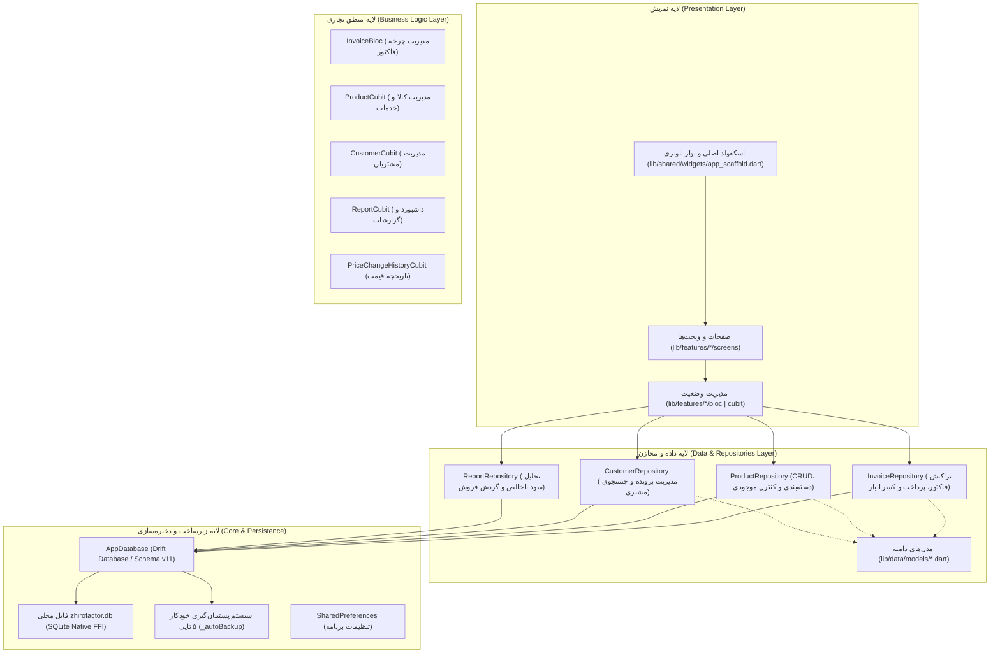
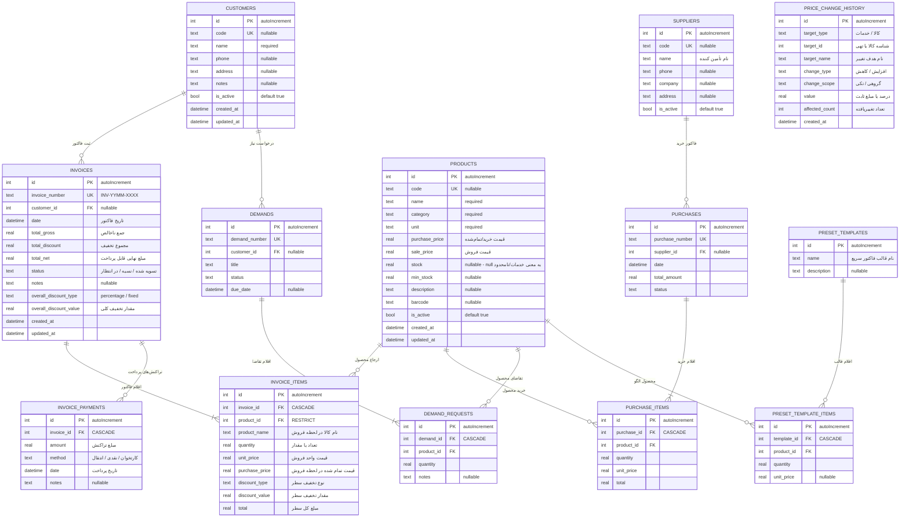
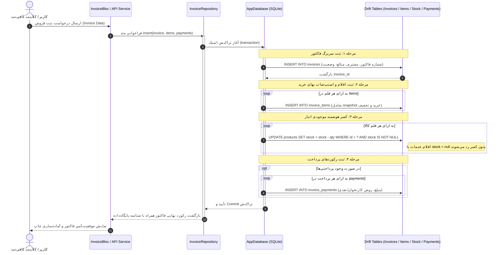
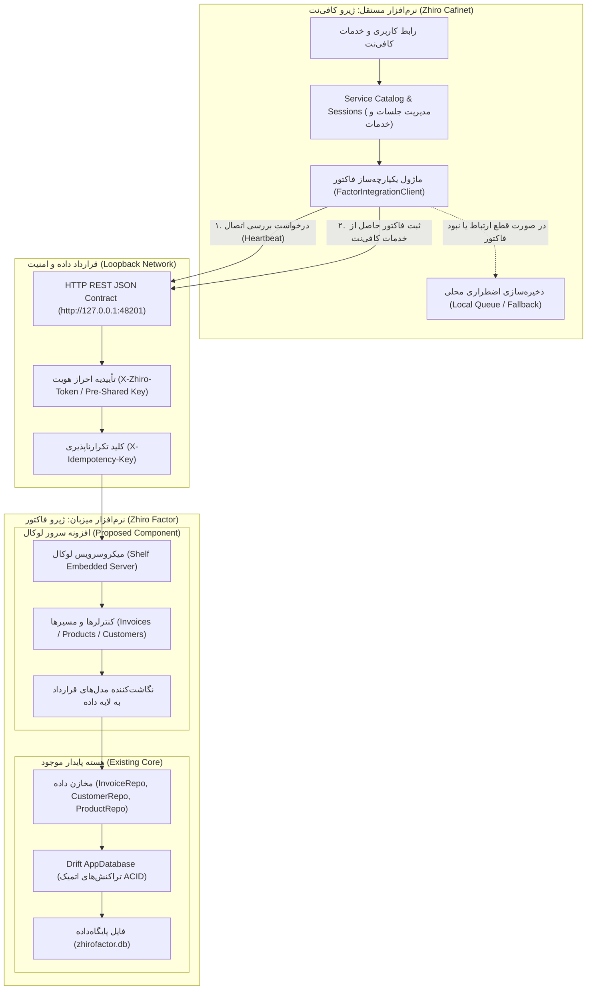

# گزارش جامع کشف معماری و ممیزی فنی ژیرو فاکتور (Zhiro Factor)
## ارزیابی معماری فعلی و الزامات یکپارچه‌سازی اختیاری با ژیرو کافی‌نت (Zhiro Cafinet)

> **تاریخ تنظیم گزارش:** آبان ۱۴۰۳ (نوامبر ۲۰۲۴)  
> **مخاطب:** تیم فنی، معمار نرم‌افزار و مدیریت محصول  
> **هدف گزارش:** ممیزی فنی و مستندسازی مبتنی بر شواهد از وضعیت موجود نرم‌افزار «ژیرو فاکتور» (کد مخزن `sales_box`) جهت طراحی و پیاده‌سازی اتصال یکپارچه و غیرهمبسته با نرم‌افزار مستقل «ژیرو کافی‌نت».  
> **وضعیت تحلیل:** فقط بازرسی و تحلیل معماری (Analysis-Only) — هیچ تغییری در کدهای اجرایی، پایگاه‌داده و پیکربندی پروژه اعمال نشده است.

---

## ۱. چکیده اجرایی (Executive Summary)

نرم‌افزار **ژیرو فاکتور** (نام پروژه در مخزن: `sales_box` و شناسه نسخه: `1.0.10`) یک برنامه دسکتاپ/موبایل مبتنی بر فریم‌ورک Flutter و زبان Dart است که به صورت تخصصی برای مدیریت صدور فاکتور، کاتالوگ کالا و خدمات، مشتریان، تأمین‌کنندگان، خرید و انبارداری محلی توسعه یافته است.

### خلاصه‌ای از وضعیت فعلی سیستم
1. **معماری پایگاه‌داده:** سیستم بر پایه کتابخانه **Drift 2.35.3** و موتور رابطه ای **SQLite** به صورت تک‌کاربره (Single-User) و لوکال (`zhirofactor.db`) کار می‌کند. نگارش کنونی شمای پایگاه‌داده نسخه **۱۱** است و از قابلیت‌های تراکنش‌های ACID و کلیدهای خارجی پشتیبانی کامل می‌کند.
2. **پوشش موجودیت‌ها:** موجودیت‌های اصلی شامل کالا و خدمات (در یک جدول مشترک با منطق موجودی `null` برای خدمات)، مشتریان، فاکتورها، اقلام فاکتور، پرداختی‌ها، تأمین‌کنندگان، خریدها، درخواست‌های نیازمندی و تاریخچه تغییرات قیمت می‌باشند. سیستم فاقد جداول کاربران/احراز هویت، مالیات، دفاتر حساب تفصیلی/معین و هزینه‌ها است.
3. **جریان کار فروش:** عملیات ثبت فاکتور به صورت کاملاً ایزوله و امن در قالب تراکنش اتمیک پایگاه‌داده (`_db.transaction`) در لایه مخزن داده (`InvoiceRepository`) مدیریت می‌شود و کسر موجودی انبار به طور خودکار فقط برای کالاهای دارای موجودی فیزیکی انجام می‌پذیرد و خدمات را مستثنی می‌کند.
4. **وضعیت زیرساخت ارتباطی و اینتگریشن:** در نگارش فعلی، **هیچ‌گونه درگاه یا رابط ارتباطی بین‌پروسسی (IPC)، وب‌سرویس لوکال (HTTP REST)، وب‌سوکت، سوکت TCP، Named Pipe یا وب‌هوک در ژیرو فاکتور پیاده‌سازی نشده است.** پایگاه‌داده صرفاً درون‌پروسسی (In-Process) و بدون امکان اتصال امن همزمان از دو برنامه مجزا مدیریت می‌شود.
5. **ارزیابی پتانسیل یکپارچه‌سازی با ژیرو کافی‌نت:** با توجه به جداسازی دقیق منطق تجاری در لایه مخازن داده (`Repositories`)، برنامه ژیرو فاکتور پتانسیل بسیار بالایی برای ارائه سرویس‌های ماژولار دارد؛ اما برای دستیابی به اتصال اختیاری، امن و بدون قفل پایگاه‌داده با «ژیرو کافی‌نت»، پیاده‌سازی یک لایه واسط **Embedded Local HTTP Server (REST API)** به همراه قراردادهای داده (Data Contracts) استاندارد، شناسه ارجاع خارجی (`external_reference_id`) و کلیدهای تکرارناپذیری (`idempotency_key`) اکیداً ضروری است.

---

## ۲. پشته فناوری و ابزارهای واقعی (Actual Technology Stack)

بر اساس بازرسی مستقیم فایل‌های پیکربندی پروژه اعم از [pubspec.yaml](file:///d:/Workspace/Flutter/sales_box/pubspec.yaml)، [analysis_options.yaml](file:///d:/Workspace/Flutter/sales_box/analysis_options.yaml) و اسکریپت‌های بیلد سیستم‌عامل‌های ویندوز و اندروید:

| مؤلفه / لایه | فناوری / کتابخانه | نسخه واقعی در مخزن | نقش و کارکرد در نرم‌افزار |
|---|---|---|---|
| **زبان برنامه‌نویسی** | Dart SDK | `^3.13.1` | زبان اصلی منطق سیستم و کلاینت |
| **فریم‌ورک رابط کاربری** | Flutter SDK | `^3.24.x / 3.27.x` | فریم‌ورک ساخت رابط کاربری چندسکویی |
| **محیط‌های هدف فعلی** | Windows Desktop & Android | Desktop (Win32/C++) / Android (Gradle Kotlin DSL) | تمرکز عملیاتی روی ویندوز دسکتاپ، آماده‌سازی ساختار اندروید |
| **مدیریت وضعیت (State)** | `flutter_bloc` | `^9.1.0` | الگوی BLoC/Cubit برای جداسازی منطق از UI |
| **موتور پایگاه‌داده** | SQLite via `drift` & `sqlite3` | `drift: ^2.35.3`<br>`sqlite3_flutter_libs: ^0.6.0+eol`<br>`sqflite_common_ffi: ^2.4.2` | ذخیره‌سازی رابطه‌ای محلی با Type-safety بالا |
| **تزریق وابستگی (DI)** | Singleton / Factory | بومی (Native Dart Pattern) | فاقد GetIt/Injectable؛ دسترسی از طریق `AppDatabase.instance` و تزریق دستی در ویجت‌ها |
| **مسیریابی (Routing)** | State-driven Navigation | بومی (`NavPage` Enum) | تغییر صفحات در [app_scaffold.dart](file:///d:/Workspace/Flutter/sales_box/lib/shared/widgets/app_scaffold.dart) بدون روتینگ اعلامی |
| **تقویم و تاریخ جلالی** | `shamsi_date`<br>`persian_datetime_picker` | `shamsi_date: ^1.1.1`<br>`persian_datetime_picker: ^3.2.0` | تبدیل تقویم شمسی/میلادی و انتخابگر تاریخ جلالی |
| **تولید و چاپ اسناد** | `pdf` & `printing` | `pdf: ^3.13.0`<br>`printing: ^5.15.0` | تولید فاکتور رسمی و حرارتی در قالب‌های A4، A5 و رول حرارتی |
| **تبادل داده (Export/Import)** | `excel_plus` & `file_picker` | `excel_plus: ^2.16.0`<br>`file_picker: ^13.3.2` | خروجی/ورودی اکسل برای محصولات، مشتریان و فاکتورها |
| **تنظیمات محلی** | `shared_preferences` | `^2.3.4` | ذخیره وضعیت تم، ابعاد چاپ فاکتور و ترجیحات ساده کاربر |
| **جعبه‌ابزار مشترک** | `prokit` | `path: ../prokit` | پکیج ابزارهای محلی برای اعتبارسنجی و تبدیل‌های عددی/تاریخی |
| **تست و آزمون خودکار** | `test` & `flutter_test` | SDK Built-in | آزمون‌های واحد و مجتمع مخازن داده (۷۴ تست موفق) |

---

## ۳. معماری کلی و ساختار لایه‌ها (Overall Architecture & Layering)

نرم‌افزار ژیرو فاکتور از یک معماری ترکیبی **Feature-First / Layered Hybrid** بهره می‌برد. منطق داده و دسترسی به پایگاه‌داده در لایه متمرکز `lib/data` قرار دارد و تعاملات کاربری بر اساس ویژگی‌ها در `lib/features` تفکیک شده‌اند.



### تفکیک مسئولیت‌ها و وضعیت لایه‌ها
1. **Presentation / UI Layer:** شامل کدهای اختصاصی هر قابلیت (مانند `invoice_create_screen.dart`, `customer_list_screen.dart`). این لایه به طور کامل از طریق رویدادها (Events) و حالت‌ها (States) کتابخانه BLoC با منطق برنامه ارتباط دارد.
2. **Business Logic Layer:** پیاده‌سازی شده در قالب BLoC و Cubit. وظیفه پردازش رویدادهای کاربر، اعتبارسنجی فرم‌ها و هماهنگی بین مخازن داده را بر عهده دارد.
3. **Data Layer (Repositories):** **نقطه قوت کلیدی معماری ژیرو فاکتور.** کلیه محاسبات مالی، مدیریت تراکنش‌ها، کسر هوشمند موجودی و خواندن/نوشتن در دیتابیس در کلاس‌های متمرکز `*Repository` کپسوله شده است. این لایه هیچ وابستگی مستقیمی به ویجت‌های Flutter ندارد و کاملاً آماده بهره‌برداری در سناریوهای یکپارچه‌سازی است.
4. **Core & Persistence Layer:** مدیریت ارتباط مستقیم با SQLite از طریق درایور Drift، مدیریت مهاجرت‌ها (Migration)، سیستم ایجاد خودکار ۵ نسخه پشتیبان در زمان بالا آمدن برنامه و ابزارهای تقویم فارسی.

---

## ۴. ساختار درختی دایرکتوری و مسئولیت ماژول‌ها (Directory Structure)

```
d:/Workspace/Flutter/sales_box/
├── android/                        # پیکربندی پلتفرم اندروید (Gradle, Manifest)
├── windows/                        # پیکربندی پلتفرم ویندوز (CMake, Runner C++)
├── lib/
│   ├── main.dart                   # نقطه ورود اصلی، راه‌اندازی FFI و دیتابیس
│   ├── app.dart                    # تنظیم تم، لوکال فارسی و MaterialApp
│   ├── core/                       # زیرساخت مشترک و مستقل از بیزینس
│   │   ├── database/               # تعاریف دیتابیس Drift و جداول
│   │   │   ├── app_database.dart   # کلاس مرکزی دیتابیس، مایگریشن و بکاپ چرخشی
│   │   │   └── tables.dart         # تعریف ۱۳ جدول Drift با انواع داده‌ها
│   │   ├── services/               # سرویس‌های زیرساختی (Backup, Export, Import)
│   │   ├── theme/                  # رنگ‌ها، تایپوگرافی و قالب دارک
│   │   └── utils/                  # ابزارهای محاسباتی، تاریخ جلالی و فرمت قیمت
│   ├── data/                       # لایه داده مرکزی
│   │   ├── models/                 # مدل‌های داده (Invoice, Product, Customer, ...)
│   │   └── repositories/           # مخازن عملیاتی ارتباط با دیتابیس
│   │       ├── invoice_repository.dart
│   │       ├── product_repository.dart
│   │       ├── customer_repository.dart
│   │       └── report_repository.dart
│   ├── features/                   # ماژول‌های مجزا بر اساس قابلیت‌ها
│   │   ├── dashboard/              # داشبورد آماری، سود و نمودارهای فروش
│   │   ├── invoice/                # صدور، پیش‌نمایش، فیلتر و پرینت فاکتور
│   │   ├── product/                # مدیریت کالا/خدمات و تغییر قیمت گروهی
│   │   ├── customer/               # مدیریت اطلاعات و سوابق مشتریان
│   │   ├── supplier/               # مدیریت طرف‌حساب‌های تأمین‌کننده
│   │   ├── purchase/               # ثبت و مدیریت فاکتورهای خرید و انبار
│   │   ├── demand/                 # سیستم مدیریت نیازمندی‌ها و درخواست‌ها
│   │   ├── reports/                # گزارشات مالی، آماری و سود و زیان
│   │   ├── backup/                 # مدیریت دستی پشتیبان‌گیری و بازیابی
│   │   └── settings/               # تنظیمات چاپ، فرمت فاکتور و اطلاعات فروشگاه
│   └── shared/                     # کامپوننت‌های عمومی UI
│       └── widgets/                # اسکفولد ناوبری (AppScaffold)، نوار ابزار، دکمه‌ها
└── test/                           # آزمون‌های واحد و ریپازیتوری (۷۴ تست موفق)
```

---

## ۵. تحلیل پایگاه‌داده و مدل داده (Database Architecture & Data Model)

پایگاه‌داده برنامه از طریق کلاس `AppDatabase` در فایل [lib/core/database/app_database.dart](file:///d:/Workspace/Flutter/sales_box/lib/core/database/app_database.dart) مدیریت می‌شود:
- **نام فایل دیتابیس:** `zhirofactor.db`
- **محل ذخیره‌سازی:** مسیر استاندارد برنامه در سیستم‌عامل (`getApplicationSupportDirectory()`)
- **نگارش فعلی شمای پایگاه‌داده:** نسخه **۱۱** (`schemaVersion = 11`)
- **کلیدهای خارجی:** در رویداد `beforeOpen` با دستور `PRAGMA foreign_keys = ON;` فعال‌سازی شده است.
- **پشتیبان‌گیری خودکار چرخان (Rolling Auto-Backup):** در هر بار لود برنامه، متد `_autoBackup()` یک کپی با تایم‌استمپ در پوشه `backups/zhirofactor_backup_*.db` ایجاد کرده و با حفظ ۵ فایل آخر، نسخه‌های قدیمی‌تر را به صورت خودکار حذف می‌کند.

### نمودار جامع موجودیت-ارتباط پایگاه‌داده (Current Database ERD)



### ۵.۱ ماتریس تحلیل ۱۳ جدول موجود در سیستم

| نام جدول (Drift / SQL) | مسئولیت بیزینسی | کلید اصلی | کلیدهای خارجی و محدودیت‌ها | نمایه (Index) و یکتایی | مدل و ریپازیتوری متناظر |
|---|---|---|---|---|---|
| **`products`** | ذخیره کاتالوگ کالاها و خدمات | `id` (INTEGER) | فاقد کلید خارجی مستقیم | `code` یکتا (اختیاری) | `Product` / `ProductRepository` |
| **`customers`** | اطلاعات پایه و تماس مشتریان | `id` (INTEGER) | فاقد کلید خارجی مستقیم | `code` یکتا (اختیاری) | `Customer` / `CustomerRepository` |
| **`invoices`** | سربرگ فاکتورهای فروش و وضعیت مالی | `id` (INTEGER) | `customer_id` -> `customers.id` | `invoice_number` یکتا | `Invoice` / `InvoiceRepository` |
| **`invoice_items`** | اقلام ردیف‌های فاکتور فروش | `id` (INTEGER) | `invoice_id` -> `invoices.id` (CASCADE)<br>`product_id` -> `products.id` | ندارد | `InvoiceItem` / `InvoiceRepository` |
| **`invoice_payments`** | رکوردهای تراکنش و روش‌های تسویه | `id` (INTEGER) | `invoice_id` -> `invoices.id` (CASCADE) | ندارد | `InvoicePayment` / `InvoiceRepository` |
| **`suppliers`** | اطلاعات طرف‌حساب‌های تأمین کالا | `id` (INTEGER) | ندارد | `code` یکتا (اختیاری) | `Supplier` / `SupplierRepository` |
| **`purchases`** | سربرگ فاکتورهای خرید از تأمین‌کننده | `id` (INTEGER) | `supplier_id` -> `suppliers.id` | `purchase_number` یکتا | `Purchase` / `PurchaseRepository` |
| **`purchase_items`** | اقلام خریداری شده و افزایش انبار | `id` (INTEGER) | `purchase_id` -> `purchases.id` (CASCADE)<br>`product_id` -> `products.id` | ندارد | `PurchaseItem` / `PurchaseRepository` |
| **`demands`** | ثبت نیازمندی‌ها و سفارش‌های مشتریان | `id` (INTEGER) | `customer_id` -> `customers.id` | `demand_number` یکتا | `Demand` / `DemandRepository` |
| **`demand_requests`** | اقلام تفکیکی درخواست نیازمندی | `id` (INTEGER) | `demand_id` -> `demands.id` (CASCADE)<br>`product_id` -> `products.id` | ندارد | `DemandRequest` / `DemandRepository` |
| **`preset_templates`** | قالب‌های پیش‌فرض فاکتور سریع | `id` (INTEGER) | ندارد | ندارد | `PresetTemplate` / `PresetTemplateRepository` |
| **`preset_template_items`** | اقلام پیش‌فرض هر قالب فاکتور | `id` (INTEGER) | `template_id` -> `preset_templates.id` (CASCADE) | ندارد | `PresetTemplateItem` / `PresetTemplateRepository` |
| **`price_change_history`** | لاگ تغییرات گروهی/تکی قیمت | `id` (INTEGER) | ندارد | ندارد | `PriceChangeHistory` / `PriceChangeHistoryRepository` |

#### موجودیت‌های مفقود یا ناموجود در دیتابیس (Verified Missing Entities):
- **کاربران و سطوح دسترسی (`Users / Roles`):** وجود ندارد (تک‌کاربره بدون لاگین).
- **مالیات و عوارض (`Taxes / TaxRates`):** وجود ندارد (سیستم مالیات محاسبه نمی‌کند).
- **حساب‌های مالی و دفتر کل (`Accounts / Ledger / CashBoxes`):** وجود ندارد؛ پرداختی‌ها فقط یک رشته متن به عنوان `method` ذخیره می‌کنند.
- **هزینه‌ها و تنخواه‌گردان (`Expenses`):** وجود ندارد.
- **رسیدهای مالی مجزا (`Receipts`):** وجود ندارد؛ وضعیت مالی در `InvoicePayments` نگهداری می‌شود.

---

### ۵.۲ مدل تفصیلی مشتری (Customer Data Model)
- **فیلدهای پیاده‌سازی شده:** `id` (کلید اصلی خودکار)، `code` (کد یکتا مانند `C001`)، `name` (نام و نام‌خانوادگی - اجباری)، `phone` (تلفن تماس - اختیاری)، `address` (آدرس - اختیاری)، `notes` (یادداشت - اختیاری)، `isActive` (فعال/غیرفعال) و زمان‌های ایجاد/ویرایش.
- **فیلدهای پشتیبانی‌نشده:** کد ملی (National ID)، کد پستی (Postal Code)، تاریخ تولد، حد اعتبار مالی (Credit Limit)، سقف بدهی و نوع شخص (حقیقی/حقوقی).
- **ارزیابی اشتراک با ژیرو کافی‌نت:** ساختار مدل مشتری در ژیرو فاکتور کاملاً مستقل از فاکتورها قابل ایجاد و خواندن است (`CustomerRepository.getAll()`). این مدل برای کافی‌نت مناسب است، اما فاقد کد ملی یا نام کاربری سامانه کافی‌نت است؛ بنابراین در یکپارچه‌سازی با ژیرو کافی‌نت، باید یک فیلد اختیاری `nationalId` یا یک نگاشت شناسه ارجاع خارجی (`external_id`) در نظر گرفته شود.

---

### ۵.۳ مدل کالا و خدمات و استراتژی موجودی انبار (Product & Service Model)
در ژیرو فاکتور، کالاها و خدمات در **یک جدول مشترک (`products`)** ذخیره می‌شوند و تفکیک آن‌ها بر اساس یک منطق مهندسی هوشمند انجام می‌گیرد:
- **کالای فیزیکی:** فیلد `stock` مقدار عددی دارد (`double` مثلاً `10.0`).
- **خدمات (Service):** فیلد `stock` برابر با **`null`** است (موجودی نامحدود). همچنین فیلد دسته‌بندی (`category`) معمولاً روی مقادیری نظیر `'خدمات'` تنظیم می‌شود.
- **منطق کسر انبار در تراکنش فروش:** در متد `insert` کلاس [lib/data/repositories/invoice_repository.dart](file:///d:/Workspace/Flutter/sales_box/lib/data/repositories/invoice_repository.dart):
  ```sql
  UPDATE products SET stock = stock - ? WHERE id = ? AND stock IS NOT NULL;
  ```
  این شرط طلایی (`AND stock IS NOT NULL`) تضمین می‌کند که فروش خدمات در ژیرو فاکتور هیچ‌گونه خطایی در دیتابیس ایجاد نکرده و تلاش برای کسر از موجودی نامحدود انجام نمی‌شود.
- **ایزولاسیون سود فروش‌های تاریخی:** فیلد `purchasePrice` در زمان فروش به عنوان اسنپ‌شات در جدول `invoice_items` ذخیره می‌شود. بنابراین تغییر بعدی در بهای خرید کالا یا بهای تمام‌شده خدمات، محاسبات سود و زیان گذشته در داشبورد را تخریب نمی‌کند.

---

## ۶. عملیات فروش، صدور فاکتور و محاسبات مالی (Sales, Invoices & Financial Operations)

### دیاگرام توالی تراکنش ثبت فروش (Sales Workflow Sequence)



### ۶.۱ محاسبات تخفیف، مالیات و وضعیت تسویه
- **تخفیف سطری (Line Item Discount):** بر روی هر قلم با دو حالت `percentage` یا `amount` اعمال شده و قبل از محاسبه مجموع سطر کسر می‌شود:
  $$ItemTotal = (Quantity \times UnitPrice) - ItemDiscount$$
- **تخفیف سربرگ (Overall Discount):** بر جمع ناخالص کل اعمال می‌شود:
  $$TotalNet = TotalGross - TotalDiscount$$
- **مالیات (Tax):** سیستم فعلی مالیات بر ارزش افزوده یا عوارض را پیاده‌سازی نکرده است ($Tax = 0$).
- **وضعیت فاکتور بر اساس پرداخت:**
  - اگر $\sum Payments \ge TotalNet$: وضعیت `'تسویه شده'` (Settled).
  - اگر $0 < \sum Payments < TotalNet$: وضعیت `'نسیه'` (Credit / Partial).
  - اگر $\sum Payments = 0$: وضعیت `'در انتظار پرداخت'` (Pending).

### ۶.۲ پاسخ به پرسش ادغام برنامه‌نویسی (Programmatic Sales Creation)

> **پرسش کارفرما:** آیا یک نرم‌افزار دیگر (ژیرو کافی‌نت) می‌تواند به صورت خودکار و برنامه‌نویسی شده درخواست صدور فاکتور یا ثبت فروش را ارسال کند؟

**پاسخ کارشناسی:**
1. **از دیدگاه منطق کد و معماری داخلی (Internal Logic):** **بله، کاملاً ممکن است.** کلاس [lib/data/repositories/invoice_repository.dart](file:///d:/Workspace/Flutter/sales_box/lib/data/repositories/invoice_repository.dart) متدی مستقل، تمیز و قدرتمند به نام `insert` دارد:
   ```dart
   Future<Invoice> insert(
     Invoice invoice, 
     List<InvoiceItem> items, 
     {List<InvoicePayment>? payments}
   )
   ```
   این متد به هیچ رابط کاربری یا کانتکست Flutter وابسته نیست. تمام محاسبات، تراکنش‌ها، کسر انبار و پرداخت‌ها را دریافت کرده و به صورت کامپوزیت و مطمئن ذخیره می‌نماید.
2. **از دیدگاه پروسس اجرایی و دسترسی بیرونی (External Process Access):** **خیر، در حال حاضر امکان‌پذیر نیست.** به دلیل اینکه ژیرو فاکتور فاقد رابط شبکه محلی (Local Web Server / REST API)، Named Pipe یا سوکت IPC است. اگر ژیرو کافی‌نت بخواهد مستقیماً فایل دیتابیس `zhirofactor.db` را باز کند، با خطای قفل دیتابیس SQLite (`database is locked` یا `SQLITE_BUSY`) و عدم همگام‌سازی کش BLoCهای ژیرو فاکتور مواجه خواهد شد.
3. **راهکار مورد نیاز:** ایجاد یک لایه **Local HTTP Micro-Service** داخلی روی پورت لوکال (مثلاً `http://127.0.0.1:48201/api/v1/invoices`) که درخواست‌های JSON ارسالی از کافی‌نت را به صورت امن دریافت کرده و متد `InvoiceRepository.insert` را فراخوانی کند.

---

## ۷. سرویس‌های برنامه و منطق تجاری (Application Services & Business Logic)

ماتریس سرویس‌های عملیاتی برنامه و ارزیابی ایمنی فراخوانی آن‌ها در یکپارچه‌سازی بیرونی:

| نام کلاس سرویس / مخزن | مسیر فایل | متدهای کلیدی | وابستگی‌ها | وضعیت ایمنی برای استفاده بیرونی |
|---|---|---|---|---|
| **`InvoiceRepository`** | `lib/data/repositories/invoice_repository.dart` | `insert`, `update`, `delete`, `getAll`, `getById`, `getInvoiceItems`, `getPayments` | `AppDatabase` | **بسیار ایمن و ایزوله** (دارای تراکنش اتمیک کامل) |
| **`ProductRepository`** | `lib/data/repositories/product_repository.dart` | `insert`, `update`, `delete`, `getAll`, `search`, `bulkUpdatePrices`, `applyPriceChange` | `AppDatabase` | **بسیار ایمن** (مناسب همگام‌سازی کاتالوگ خدمات) |
| **`CustomerRepository`** | `lib/data/repositories/customer_repository.dart` | `insert`, `update`, `delete`, `getAll`, `getById`, `search`, `getByCode` | `AppDatabase` | **بسیار ایمن** (مناسب اشتراک پرونده مشتریان) |
| **`ReportRepository`** | `lib/data/repositories/report_repository.dart` | `getDashboardSummary`, `getProductSales`, `getSalesTrend`, `getCategorySales` | `AppDatabase` | **ایمن (فقط خواندنی)** |
| **`InvoiceNumberGenerator`**| `lib/core/utils/invoice_number_generator.dart`| `generate(int counter, {DateTime? date})` | `shamsi_date` | **ایمن (تابع خالص Pure Function)** |
| **`BackupService`** | `lib/core/services/backup_service.dart` | `createBackup`, `restoreBackup`, `getBackupFiles` | `path_provider`, File IO | **حساس و مخاطره‌آمیز** (نیازمند بستن دیتابیس) |
| **`ExportService`** | `lib/core/services/export_service.dart` | `exportProductsToExcel`, `exportInvoicesToExcel` | `excel_plus`, File IO | **ایمن (فقط خواندنی)** |
| **`ImportService`** | `lib/core/services/import_service.dart` | `importProductsFromExcel` | `ProductRepository` | **ایمن برای کارهای دسته‌ای** |

---

## ۸. قابلیت‌های یکپارچه‌سازی و ارتباطی فعلی (Current Integration Capabilities)

بررسی جامع لایه‌های ارتباطی در مخزن پروژه:

- **رابط‌های REST API بیرونی یا سرور لوکال:** هیچ سرور HTTP (نظیر `shelf` یا `dart:io HttpServer`) در پروژه وجود ندارد.
- **وب‌سوکت یا پیام‌رسانی بلادرنگ:** پیاده‌سازی نشده است.
- **سوکت خام TCP / UDP یا Named Pipes:** هیچ سوکتی برای تبادل پیام باز نشده است.
- **تعامل از طریق خط فرمان (CLI Interface / Daemon):** برنامه فاقد ورودی‌های آرگومان خط فرمان برای ثبت فاکتور یا صدور کالا است.
- **تبادل فایل متنی یا وب‌هوک:** هیچ مکانیزم نظارت بر فایل (File Watcher) یا ارسال وب‌هوک تعریف نشده است.
- **اشتراک فایل دیتابیس:** در حال حاضر تنها راه تعامل فیزیکی، باز کردن مستقیم فایل `zhirofactor.db` توسط یک پروسس دیگر است که به دلیل مخاطرات تخریب دیتابیس، تخطی از اصول معماری است.

---

## ۹. احراز هویت، امنیت و مجوزها (Authentication & Security)

1. **وضعیت لاگین و کاربری:** برنامه به صورت **تک‌کاربره آفلاین** طراحی شده است. هیچ صفحه ورود، اعتبارسنجی رمز عبور، مدیریت نشست (Session) یا سطوح دسترسی مبتنی بر نقش (RBAC) وجود ندارد.
2. **رمزنگاری پایگاه‌داده (Database Encryption):** دیتابیس SQLite با موتور پیش‌فرض SQLite3 کامپایل شده و فاقد پسورد یا افزونه‌های رمزنگاری نظیر **SQLCipher** است. داده‌ها به صورت متن آشکار (Plaintext) در مسیر محلی سیستم ذخیره می‌شوند.
3. **ریسک‌های امنیتی برای اینتگریشن:**
   - اگر وب‌سرویس لوکال برای ارتباط با ژیرو کافی‌نت بالا آورده شود، باید حتماً مقید به حلقه محلی (`127.0.0.1`) باشد و هرگز روی `0.0.0.0` باز نشود تا از نفوذ سایر دستگاه‌های شبکه محلی (LAN) بدون احراز هویت جلوگیری شود.
   - توصیه می‌شود یک توکن مشترک (Pre-Shared API Key) یا Secret محلی بین کافی‌نت و فاکتور برای تبادل امن داده‌ها تبادل گردد.

---

## ۱۰. پشتیبان‌گیری، بازیابی و قابلیت جابجایی داده‌ها (Backup & Restore)

1. **پشتیبان‌گیری خودکار (Auto-Backup):**
   - در فایل [app_database.dart](file:///d:/Workspace/Flutter/sales_box/lib/core/database/app_database.dart#L44-L68)، در هر بار اجرای برنامه متد `_autoBackup` فراخوانی می‌شود.
   - بکاپ‌ها با فرمت `zhirofactor_backup_yyyyMMdd_HHmmss.db` در دایرکتوری `backups` ذخیره می‌گردند.
   - سقف نگهداری بکاپ‌ها ۵ نسخه است و به محض ایجاد نسخه ششم، قدیمی‌ترین فایل به صورت خودکار حذف می‌شود.
2. **پشتیبان‌گیری دستی و بازیابی:**
   - از طریق ماژول [backup_service.dart](file:///d:/Workspace/Flutter/sales_box/lib/core/services/backup_service.dart) با انتخاب مسیر توسط کاربر، یک کپی معتبر از فایل SQLite ذخیره یا بازنویسی می‌شود.
3. **انتقال داده‌ها از طریق اکسل:**
   - امکان خروجی گرفتن از کل کاتالوگ محصولات و فهرست فاکتورها در قالب اکسل `.xlsx` برای مهاجرت داده‌ها پیاده‌سازی شده است.

---

## ۱۱. تنظیمات و پیکربندی برنامه (Settings & Customization)

تنظیمات برنامه در حال حاضر به جای دیتابیس، در فایل محلی **`SharedPreferences`** نگهداری می‌شوند:
- نام و اطلاعات فروشگاه جهت چاپ در سربرگ فاکتور (نام فروشگاه، تلفن، آدرس، لوگو، پیام فوتر).
- قالب چاپ پیش‌فرض فاکتور (اندازه صفحه A4، A5 یا فیش حرارتی ۸۰ میلی‌متری).
- وضعیت نمایش یا عدم نمایش ستون تخفیف در فاکتور چاپی.
- وضعیت تم برنامه (تیره / روشن از طریق `ThemeCubit`).

---

## ۱۲. وابستگی‌های خارجی و محدودیت‌های پلتفرم (Platform Constraints)

1. **محدودیت موتور SQLite در ویندوز:** ژیرو فاکتور روی دسکتاپ ویندوز به صورت Native از طریق `sqflite_common_ffi` و DLL محلی `sqlite3.dll` به دیتابیس وصل می‌شود. به دلیل مکانیزم File Locking در سیستم‌عامل ویندوز، اگر ژیرو کافی‌نت بخواهد همزمان همین فایل را مستقیماً از روی دیسک باز کند، با ارور `database is locked` مواجه خواهد شد.
2. **پلتفرم اندروید:** اتصال به پایگاه‌داده در اندروید از طریق سوکت یا مسیر اختصاصی سندباکس اپلیکیشن انجام می‌شود و هیچ برنامه‌ای در اندروید اجازه دسترسی مستقیم به سندباکس دایرکتوری برنامه دیگر را ندارد. بنابراین اتصال اشتراک فایل مستقیم در اندروید از نظر سیستم‌عامل **غیرممکن** است و نیاز به ارتباط شبکه‌ای یا ContentProvider دارد.
3. **طراحی واکنش‌گرا (Responsive Layout):** برنامه اخیراً به کامپوننت‌های ریسپانسیو و پشتیبانی از ابعاد موبایل، تبلت و دسکتاپ مجهز شده است.

---

## ۱۳. ارزیابی عمیق سناریوهای یکپارچه‌سازی با ژیرو کافی‌نت (Integration Scenarios)

| سناریوی ادغام | شرح مکانیزم فنی | مزایا | معایب، ریسک‌ها و موانع فنی | نمره امکان‌پذیری و ریسک |
|---|---|---|---|:---:|
| **سناریو A: اشتراک مستقیم فایل دیتابیس (Direct SQLite Sharing)** | اتصال مستقیم دو برنامه به یک فایل واحد `zhirofactor.db` | عدم نیاز به برنامه‌نویسی شبکه؛ سرعت بالای اجرا در حالت تک‌پروسس | **ریسک بحرانی:** تداخل شدید قفل دیسک (`SQLITE_BUSY`) در ویندوز؛ غیرممکن بودن در اندروید به دلیل سندباکس امنیتی؛ ناهماهنگی وضعیت کش BLoCهای ژیرو فاکتور و عدم اطلاع از تغییرات؛ دور زدن منطق کسر انبار | **مردود (توصیه نمی‌شود)**<br>ریسک بسیار بالا |
| **سناریو B: پکیج هسته و مدل مشترک (Shared Core Package / Drift Schema)** | تفکیک جداول دیتابیس و مدل‌ها در یک ماژول مجزا (مانند `zhiro_core`) | یکدستی کدها و ساختار موجودیت‌ها؛ جلوگیری از کدهای تکراری | مشکل ارتباط حین اجرا (Runtime IPC) بین دو پروسس مستقل را حل نمی‌کند و در نهایت نیاز به سناریو C دارد | **مفید به عنوان مکمل سناریو C**<br>ریسک پایین |
| **سناریو C: وب‌سرویس لوکال درون‌برنامه‌ای (Embedded Local REST API)** | فعال‌سازی یک سرور سبک لوکال (با پکیج `shelf`) داخل ژیرو فاکتور روی پورت اختصاصی `127.0.0.1` | **تفکیک کامل وابستگی‌ها؛** امکان ادامه کار کافی‌نت در نبود فاکتور (Fallback Mode)؛ رعایت کامل تراکنش‌های دیتابیس و کسر انبار؛ سازگاری کامل با اندروید و ویندوز؛ حفظ امنیت کامل | نیاز به اضافه کردن پکیج سرور سبک به فاکتور و تعریف اندپوینت‌های REST | **بهترین گزینه معماری (توصیه اکید)**<br>ریسک بسیار پایین |
| **سناریو D: همگام‌سازی ابری مرکزی (Cloud Central Sync)** | ایجاد سرور ابری و همگام‌سازی دوره‌ای دیتابیس هر دو نرم‌افزار | کارکرد چنددستگاهی و تحت وب در آینده دور | وابستگی دائمی به اینترنت؛ نیاز به زیرساخت و هزینه‌های سرور ابری؛ پیچیدگی مدیریت کانفلیکت‌های آفلاین | **پیچیده برای فاز فعلی**<br>مناسب فازهای توسعه آتی |

---

## ۱۴. معماری پیشنهادی یکپارچه‌سازی (Recommended Integration Architecture)

معماری پیشنهادی بر پایه **سناریو C (Embedded Local HTTP Server with REST API)** طراحی شده است. ژیرو کافی‌نت کلاینتی مستقل و بدون وابستگی اجباری باقی می‌ماند و ژیرو فاکتور در نقش **ارائه‌دهنده خدمات مالی و فاکتور (Invoice & Sales Provider)** عمل می‌کند.

### نمودار معماری ادغام پیشنهادی (Proposed Integration Architecture)



### اصول کلیدی این معماری:
1. **استقلال کامل کافی‌نت (Zero Mandatory Dependency):** ژیرو کافی‌نت دارای یک کلاینت اختصاصی است (`FactorIntegrationClient`). در صورتی که کاربر ژیرو فاکتور را نصب نکرده باشد یا برنامه فاکتور بسته باشد:
   - کافی‌نت کماکان فعالیت عادی خود را انجام می‌دهد.
   - فاکتورهای صادره در یک صف لوکال (`Local Queue`) در کافی‌نت ذخیره می‌شوند تا به محض در دسترس قرار گرفتن فاکتور، همگام‌سازی شوند.
2. **پورت ثابت و امنیت لوپ‌بک:** سرور لوکال فاکتور فقط روی اینترفیس لوپ‌بک `127.0.0.1:48201` گوش می‌دهد و به هیچ وجه روی اینترنت یا شبکه محلی اکسپوز نمی‌شود.
3. **قراردادهای داده (Data Contracts) و فیلد شناسایی خارجی:**
   - ارسال فاکتور همراه با یک فیلد الزامی `externalReferenceId` (مثلاً `CAFINET-SES-10492`) انجام می‌شود تا در فاکتور ثبت گردد.
   - ارسال هدر `X-Idempotency-Key` مانع از صدور فاکتور تکراری در صورت قطعی موقت ارتباط حین ارسال می‌شود.
4. **تطبیق خدمات کافی‌نت با کاتالوگ ژیرو فاکتور:**
   - ژیرو کافی‌نت می‌تواند فهرست خدمات ژیرو فاکتور را بخواند (`GET /api/v1/services`).
   - در صورت ارسال خدمت جدید از کافی‌نت، ژیرو فاکتور آن را به عنوان یک رکورد با `stock: null` و `category: 'خدمات کافی‌نت'` در جدول `products` اضافه می‌کند تا کسر انبار برای آن انجام نشود.

---

## ۱۵. جدول تحلیل ریسک‌ها و اقدامات پیشنهادی بر اساس اولویت (Risk & Action Table)

| ردیف | شرح ریسک فنی | سطح ریسک | مؤلفه درگیر | اقدام مهندسی پیشنهادی جهت برطرف‌سازی | اولویت اجرایی |
|:---:|---|:---:|---|---|:---:|
| **۱** | تداخل قفل فایل SQLite در صورت اتصال همزمان پروسس‌ها | **بحرانی** | Database / SQLite | پرهیز اکید از سناریوی اشتراک مستقیم فایل؛ استفاده از معماری سرور لوکال (سناریو C). | **P0 (الزامی)** |
| **۲** | صدور فاکتورهای تکراری در بازخوانی‌ها و قطع ارتباط | **بالا** | Invoices / API | افزودن فیلد `externalReferenceId` به جدول فاکتور و کنترل هدر `Idempotency-Key`. | **P0 (الزامی)** |
| **۳** | عدم وجود فیلدهای کد ملی و شناسه ارجاع مشتری | **متوسط** | Customers | افزودن فیلد اختیاری `nationalId` و `externalId` در نسخه ۱۲ دیتابیس فاکتور. | **P1 (مهم)** |
| **۴** | عدم وجود شناسه یکتای جهانی (UUID) در جداول | **متوسط** | All Entities | استفاده از شناسه ترکیبی یا افزودن فیلد `uuid` اختیاری برای جلوگیری از کانفلیکت شناسه‌ها. | **P1 (مهم)** |
| **۵** | تداخل شماره فاکتورهای همزمان | **متوسط** | Number Generator | انحصاری کردن تولید شماره فاکتور در لایه دیتابیس ژیرو فاکتور؛ کافی‌نت فقط شماره موقت تولید کند. | **P1 (مهم)** |
| **۶** | باز شدن ناخواسته پورت روی شبکه محلی | **بالا** | Network / Security | مقید ساختن کامل سرور لوکال صرفاً به آی‌پی `127.0.0.1` به همراه توکن تصدیق اصالت محلی. | **P0 (الزامی)** |
| **۷** | محدودیت اجرا در اندروید (عدم اشتراک پورت بین اپ‌ها) | **متوسط** | Mobile Deployment | استفاده از Android Intent / Deep Link یا Bound Service در صورت مهاجرت آتی به اندروید. | **P2 (آتی)** |

---

## ۱۶. پرسش‌های باز و نیازمند شفاف‌سازی از کارفرما (Open Questions)

جهت نهایی‌سازی طراحی پروتکل یکپارچه‌سازی، تصمیم‌گیری کارفرما در خصوص موارد زیر الزامی است:

1. **مدل استقرار دو برنامه:** آیا ژیرو کافی‌نت و ژیرو فاکتور همیشه بر روی **یک رایانه ویندوزی مشترک** نصب خواهند شد یا ممکن است ژیرو کافی‌نت روی یک سیستم کلاینت و ژیرو فاکتور روی سیستم حسابداری/سرور همان شبکه باشد؟  
   *(پاسخ به این سوال، امکان ارتقای سرور لوکال به یک وب‌سرویس دارای احراز هویت در سطح شبکه داخلی (LAN) را مشخص می‌سازد).*
2. **مرجعیت کاتالوگ خدمات:** آیا فهرست خدمات کافی‌نت (مانند پرینت، اسکن، ثبت‌نام کنکور، پرداخت قبوض) در نرم‌افزار کافی‌نت تعریف می‌شود و به فاکتور ارسال می‌گردد، یا برعکس، متصدی کافی‌نت باید ابتدا خدمات را در ژیرو فاکتور تعریف کرده و کافی‌نت آن را فراخوانی کند؟
3. **مدیریت مشتریان مشترک:** در صورتی که مشخصات یک مشتری (مثلاً شماره تماس) در کافی‌نت ویرایش شود، آیا این تغییر باید به صورت خودکار پرونده مشتری در ژیرو فاکتور را به‌روزرسانی کند (همگام‌سازی دوطرفه) یا مشخصات فاکتور ارجحیت دارد؟
4. **تخفیفات اختصاصی:** آیا تخفیفات اعطایی به کاربران کافی‌نت (مثلاً تخفیف پلکانی یا اشتراک ویژه) مستقیماً به عنوان تخفیف سطری در فاکتور ژیرو فاکتور ثبت شود یا به عنوان ردیف خدمت مجزا؟

---

## ۱۷. جمع‌بندی و گام‌های بعدی (Conclusion & Roadmap)

کد مخزن **ژیرو فاکتور** از حیث ساختار لایه داده، تفکیک وظایف و انتزاع مخازن داده در وضعیت **بسیار مطلوب و استاندارد** قرار دارد. منطق ثبت فاکتور و تفکیک کالا از خدمات با دقت پیاده‌سازی شده و پایگاه‌داده از امنیت تراکنشی ACID بالایی برخوردار است.

### نقشه راه عملیاتی برای فاز بعدی (فاز طراحی و پیاده‌سازی اینتگریشن):
1. **گام اول (ژیرو فاکتور):** تعریف نسخه ۱۲ پایگاه‌داده جهت افزودن ستون‌های `external_reference_id` به جدول `invoices` و `national_id` به جدول `customers`.
2. **گام دوم (ژیرو فاکتور):** پیاده‌سازی یک افزونه سبک `shelf` به عنوان `FactorHttpBridge` در لایه Core با اندپوینت‌های:
   - `GET /health` (بررسی زنده بودن سرویس)
   - `GET /api/v1/customers` و `POST /api/v1/customers`
   - `GET /api/v1/products` (فیلتر شده بر روی خدمات)
   - `POST /api/v1/invoices` (ثبت اتمیک فاکتور فروش)
3. **گام سوم (ژیرو کافی‌نت):** پیاده‌سازی کلاس `FactorApiClient` در کافی‌نت با قابلیت تشخیص خودکار آفلاین/آنلاین بودن ژیرو فاکتور و ذخیره در صف محلی در صورت در دسترس نبودن فاکتور.
4. **گام چهارم:** نگارش تست‌های مجتمع End-to-End بین دو نرم‌افزار جهت اطمینان از صحت محاسبات سود، کسر نشدن موجودی خدمات و صدور صحیح اسناد چاپی.

